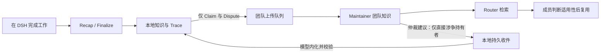

# ACN记忆框架 · agent-claim-network

[English](README_EN.md)

**从agent工作轨迹中沉淀可复用的知识与记忆，让知识经验在团队中流动。**

ACN记忆框架是 DeepSeek Harness（DSH）的知识与记忆插件。它把工作中的经验整理成可引用、可修订的知识，让新会话有机会复用之前的成果；也可连接 ACN 团队服务，在多个 Agent 之间分享知识和处理争议。

本仓库包含插件的 TypeScript 实现、网页配置界面、模型提示词和自动化测试。Router 与 Maintainer 是独立部署的 ACN 服务，插件提供与它们通信的客户端。

DSH 继续负责 Agent 主循环、上下文压缩、会话和读写文件等默认工具。ACN 负责知识与记忆，不替换这些宿主能力。

插件使用同一 JavaScript 安装包，桌面可用平台以 DSH 宿主支持范围为准。macOS 已完成本机回归；Windows 路径及文件保护已补齐，并配置 Windows CI，尚未完成 Windows 桌面实机验收。平台验证范围见 [DSH 兼容边界](docs/dsh-compat.md#操作系统)。

## 从哪里开始

- **第一次安装：** [带截图的使用指南](docs/user-guide.md)，从本地安装包到模型配置，再完成一次知识形成与复用。
- **已经在使用：** [配置说明](docs/config.md)、[命令与行为参考](docs/command-reference.md)、[常见限制](docs/outstanding-issues.md)。
- **参与开发：** [架构说明](docs/architecture.md)、[开发指南](docs/development.md)。


## 能做什么

| 能力 | 使用效果 |
| --- | --- |
| Claim 知识与 Trace 来源 | 保存带适用范围、证据摘要和置信度的经验；按需检索、阅读、修订并追溯工作来源 |
| Recap / Finalize | 手动 `/recap`、批量或尾部空闲、宿主压缩及归档收尾时提炼知识；只处理增量，归档后暂停自动触发 |
| 私有 Memory | 用 `MEMORY.md` / `USER.md` 保存个人经验与偏好，新会话读取冻结快照，定期复核优先保留对话信号；不直接上传团队 |
| Dream | 清理一次性记录、整合同主题知识、追溯关联 Trace；可选工作区查证，保留有效条件与证据限制，工具参数 JSON 格式失败时有限自动重试 |
| 团队协作 | 管理多份单人或团队工作配置，按项目最近会话或全局默认预选归属；经 Router 查找知识，经 Maintainer 接收建议，内化后才改变本地知识 |
| 知识与活动界面 | 按身份浏览 Claim、Dispute、Trace，查看后台结果、警告、未完成项、历史失败与投递恢复；浏览不触发模型 |
| 持久任务与迁移 | 中断后恢复后台任务，模型失败显示分类并有界重试；只读导入已有 ACN 的 Claim、Trace 和私有文件 |

单人模式无需团队服务，也不会发送团队请求。同一 upstream 下的不同项目共用知识和私有记忆，不同 upstream 独立存储。可以为原单人配置添加团队服务，继续使用原身份与知识库。后台模型和聊天模型分别选择，均可使用 DSH 中已配置的模型。

ACN 后台任务默认输出上限为 32768 token，可通过 `llm.maxOutputTokens` 调整；已有显式配置保持生效，详见[配置参考](docs/config.md)。

知识的形成、团队投递和接收内化是不同阶段：



上图展示团队路径；单人模式只保留本地链路。Trace 与私有 Memory 不进入团队上传队列。仲裁完成或收件已确认，都不等于本地 Claim 已完成修订。

## 安装概览

当前 `0.1.0` 尚未发布，可从源码构建本地安装包，需要 Node `^22.19.0 || >=24.0.0` 与 pnpm `11.25.0`：

```sh
pnpm install --frozen-lockfile
pnpm pack --pack-destination .artifacts
```

启动 DSH，在「插件 → 添加插件」填入生成的 `.tgz` 绝对路径，安装并启用。打开「设置 → ACN 插件设置」，在「工作配置」创建 Agent 身份，首份配置成为全局默认；在「知识与模型」选择后台模型。每份配置都能单人使用，也能在原身份上接入团队。新会话自动沿用同项目最近新建会话的配置，没有可用记录时采用全局默认，首发前可改选；无需单独设置项目默认或安装额外兼容扩展。聊天框的 **ACN** 菜单提供知识浏览、复盘和团队同步。完整步骤见[使用指南](docs/user-guide.md)。

启用／停用在工作配置列表中操作；编辑期间先保存或取消，避免丢弃草稿。

默认团队或个人配置也可在「偏好 → 默认工作配置」调整；「偏好」提供六项高级参数。知识页支持分类、状态与待投筛选，活动页支持类型、来源与结果筛选。

只有安装插件后新建、尚未发送消息的空白会话可选择工作配置；首次配置前创建的这类草稿也可使用。安装前的旧会话，以及未选择配置就已开始聊天的会话，都能继续普通聊天，但不能中途绑定团队，也不启用 ACN 知识或私有 Memory。已绑定的会话首发后不能切换归属。

团队鉴权密钥可直接粘贴、切换显隐，并随配置保存到 DSH 托管存储；插件配置只保留内部引用。

DSH 版本声明范围为 `>=0.2.1-rc.2 <0.3.0`，兼容基线为 `0.2.1-rc.2`。包名为 `dsh-plugin-acn`；中文名为 **ACN记忆框架**，英文名为 **agent-claim-network**。

## 仓库结构

| 路径 | 内容 |
| --- | --- |
| `src/` | 知识、记忆、存储、团队客户端，以及 DSH 适配和网页配置界面 |
| `prompts/` | 知识形成、整理、内化与记忆复核的模型提示词 |
| `cordis.patch.yml` | 插件组件的组合与注册配置 |
| `locale/` | 中英文本地化资源 |
| `tests/` | 单元、集成、协议契约、并发与崩溃恢复测试 |
| `scripts/` | 兼容性检查、安装检查和本地团队服务测试脚本 |
| `docs/` | 使用、配置、架构和开发文档 |

## 开发与测试

安装依赖后，在仓库根目录运行：

```sh
pnpm typecheck
pnpm lint
pnpm check:security
pnpm check:docs
pnpm test
```

`pnpm test` 会先构建插件。常规自动化测试使用临时目录和本地测试模型；团队契约测试需要独立的 ACN 源码仓库。构建、测试、打包和安装检查应串行执行，完整命令见[开发指南](docs/development.md)。

## 团队使用

团队成员各自维护本地知识，通过 Router 发现其他成员分享的 Claim。遇到知识冲突时，可向 Maintainer 提交争议；自动仲裁还需在服务端配置模型并启用。可采纳的裁决建议通过 Inbox 送达直接涉争 Claim 的持有者，经各自内化后才可能更新本地知识。其他成员通过 Router 查询后续共享版本，并非接收全员广播。


[文档导航](docs/index.md) · [架构](docs/architecture.md) · [开发指南](docs/development.md) · [更新记录](CHANGELOG.md)

许可证：[MIT](LICENSE-MIT) 或 [Apache-2.0](LICENSE-APACHE)。

## ACN 原仓库

ACN 原生应用、Router 和 Maintainer 的源码与使用说明见 [FTShare-Lab/agent-claim-network](https://github.com/FTShare-Lab/agent-claim-network)。本仓库维护其 DSH 插件实现。
