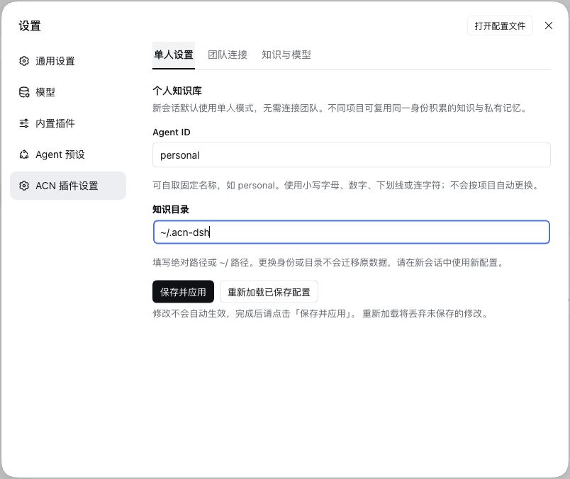

# agent-claim-network

[中文](README.md)

**Distill reusable knowledge and memories from agent work traces, and let experience flow across your team.**

ACN adds knowledge and private memory to DeepSeek Harness (DSH). DSH still owns the agent loop, context compaction, sessions and default file tools. ACN does not replace the host harness.

This repository contains the TypeScript plugin, its web configuration page, model prompts and automated tests. Router and Maintainer are separately deployed ACN services; the plugin provides their clients.

## Capabilities

| Feature | What it does |
| --- | --- |
| Claims and Traces | Store scoped, referenceable knowledge with evidence, confidence and provenance; read and revise it when relevant |
| Recap and Finalize | Form knowledge through `/recap`, batch or tail idle periods, host compaction, and archive finalization; process increments and pause automatic work after archival |
| Private Memory | Maintain `MEMORY.md` and `USER.md`, with frozen session snapshots, periodic reviews that prioritize dialogue, and no direct team upload |
| Dream | Clean up and consolidate knowledge, trace its local provenance, and optionally check workspace files while preserving valid conditions and evidence limits |
| Team collaboration | Discover claims through ACN Router, deliver knowledge to Maintainer and internalize its suggestions locally |
| Recovery and import | Resume interrupted background work and import existing ACN knowledge without overwriting targets |

## Install and configure

Version `0.1.0` remains unpublished. Build a local package from source with Node `^22.19.0 || >=24.0.0` and pnpm `11.25.0`:

```sh
pnpm install --frozen-lockfile
pnpm pack --pack-destination .artifacts
```

In DSH, open **Plugins**, expand **Add plugin**, choose the third-party installation option and enter the tarball's absolute path. Install, enable and open **agent-claim-network**. **Settings → ACN settings** and the plugin detail show the same tabs: **Personal**, **Team connections**, and **Knowledge and model**. Set the identity and directory on the Personal tab, then click **Save and apply**. A background model is saved only after its availability check succeeds. Add named team connections as needed. In the composer, open **ACN** to browse knowledge or recap. New sessions start in solo mode; select a team before the first message to enable **Sync Inbox**. Sync feedback appears outside the composer. That binding stays fixed after sending. **Reload saved configuration** discards unsaved edits.

Solo mode needs no team services. Choose a stable ID such as `personal`; all projects using the same ID and directory share knowledge and private memory. Team members need distinct IDs matching their service authorization. Each named connection stores its member identity, both service URLs and the credential environment variable **name**, never its value. Connections have separate knowledge and private memory stores. First selection waits for Inbox processing; later sync failures provide recovery controls without blocking ordinary work.

Chat and background models are selected separately from the models configured in DSH. Changing identity or storage location does not migrate data; start a new session after either change. Private memory review sends its input to the configured model provider, not to team services.

ACN background tasks default to a 32,768-token output limit. Explicit `llm.maxOutputTokens` settings continue to take precedence; see the [configuration reference](docs/config.md).



The declared DSH version range is `>=0.2.1-rc.2 <0.3.0`, with `0.2.1-rc.2` as the compatibility baseline. The package identifier is `dsh-plugin-acn`; the Chinese display name is **ACN记忆框架**.

Browse public Claims, Disputes and Traces from the conversation **Knowledge** button. The **Activity** tab shows results, source sessions and explicit retry controls. Browsing never syncs or calls a model. Local completion and team delivery are separate states. Brief result notices appear only in the visible, focused source session.

## Repository layout

| Path | Contents |
| --- | --- |
| `src/` | Knowledge, memory, storage, team clients, DSH integration and web configuration |
| `prompts/` | Model prompts for knowledge formation, consolidation, internalization and memory review |
| `cordis.patch.yml` | Plugin component composition and registration |
| `locale/` | Chinese and English localization resources |
| `tests/` | Unit, integration, protocol contract, concurrency and crash recovery tests |
| `scripts/` | Compatibility checks, installation checks and local team service tests |
| `docs/` | Usage, configuration, architecture and development documentation |

## Development and testing

After installing dependencies, run these commands from the repository root:

```sh
pnpm typecheck
pnpm lint
pnpm check:security
pnpm check:docs
pnpm test
```

`pnpm test` builds the plugin first. Regular automated tests use temporary directories and local test models. Team contract tests require a separate ACN source checkout. Run builds, tests, packaging and installation checks sequentially; see the [development guide](docs/development.md) for the complete commands.

## Team usage and limitations

Each team member maintains local knowledge and uses Router to discover Claims shared by others. Members can submit conflicting knowledge to Maintainer as disputes. Its suggestions arrive through Inbox and update each member's local knowledge only after internalization.

Use a **Router without LLM reranking**: changes in reranked candidate sets can block automatic arbitration adoption. Knowledge reuse depends on the agent retrieving and applying relevant Claims. Evidence records and Dream's citation checks do not guarantee factual accuracy; scope and evidence limitations still matter. Memory protection is not an operating-system sandbox.

Further documentation is in Chinese: [documentation index](docs/index.md), [illustrated user guide](docs/user-guide.md), [configuration](docs/config.md), [command reference](docs/command-reference.md), [limitations](docs/outstanding-issues.md), [development](docs/development.md), [architecture](docs/architecture.md). See the [changelog](CHANGELOG.md) for version changes.

License: [MIT](LICENSE-MIT) OR [Apache-2.0](LICENSE-APACHE).

## Original ACN repository

The native ACN application, Router and Maintainer are maintained in [FTShare-Lab/agent-claim-network](https://github.com/FTShare-Lab/agent-claim-network), along with their usage documentation. This repository maintains the DSH plugin implementation.
