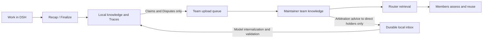
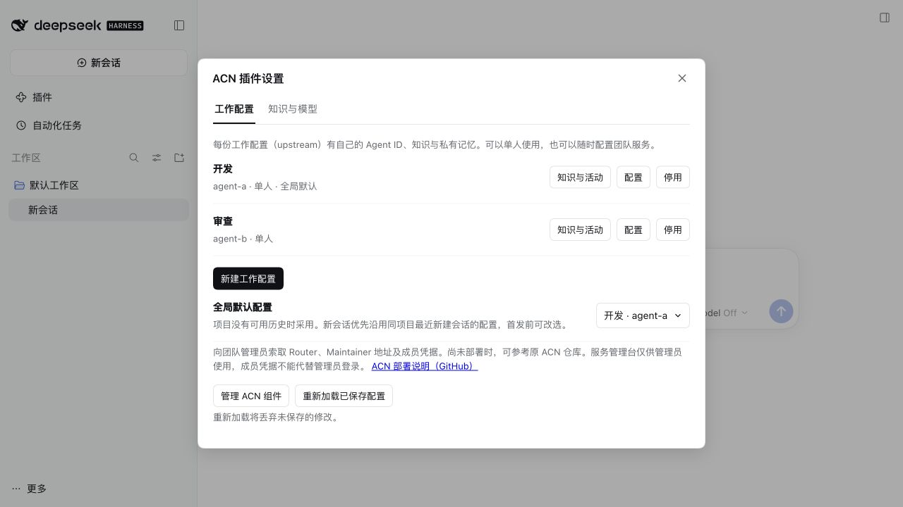

# agent-claim-network

[中文](README.md)

**Distill reusable knowledge and memories from agent work traces, and let experience flow across your team.**

ACN adds knowledge and private memory to DeepSeek Harness (DSH). DSH still owns the agent loop, context compaction, sessions and default file tools. ACN does not replace the host harness.

This repository contains the TypeScript plugin, its web configuration page, model prompts and automated tests. Router and Maintainer are separately deployed ACN services; the plugin provides their clients.

## Capabilities

| Feature | What it does |
| --- | --- |
| Claims and Traces | Store scoped, referenceable knowledge with evidence, confidence and provenance; read and revise it when relevant |
| Recap and Finalize | Form knowledge through `/recap`, batch or tail idle periods, host compaction, and archive finalization; process increments and pause automatic work after archival |
| Private Memory | Maintain `MEMORY.md` and `USER.md`, with frozen session snapshots, periodic reviews that prioritize dialogue, and no direct team upload |
| Dream | Clean up and consolidate knowledge, trace its local provenance, and optionally check workspace files while preserving valid conditions and evidence limits; retry malformed tool JSON within a fixed limit |
| Work configurations | Save multiple solo or team upstreams, inherit the newest conversation configuration per project, with a global fallback, and keep session ownership and private stores separate |
| Team collaboration | Discover claims through ACN Router, deliver knowledge to Maintainer and internalize its suggestions locally |
| Recovery and import | Resume interrupted background work, classify model failures with bounded retries, and import existing ACN knowledge without overwriting targets |

## Install and configure

Version `0.1.0` remains unpublished. Build a local package from source with Node `^22.19.0 || >=24.0.0` and pnpm `11.25.0`:

```sh
pnpm install --frozen-lockfile
pnpm pack --pack-destination .artifacts
```

In DSH, open **Plugins**, add the tarball by its absolute local path, then enable **agent-claim-network**. **Settings → ACN settings** and the plugin detail share two tabs, **Work configurations** and **Knowledge and model**. Create a work configuration with an Agent ID; its display name is optional. The first configuration becomes the global default. New sessions inherit the configuration of the most recently created ordinary conversation in the same project. They fall back to the global default when no valid record is available. Users can change the selection before the first message; existing sessions and drafts retain their bindings. No project preference UI or additional host compatibility package is required.

A blank conversation created before initial setup can be initialized by choosing its configuration in the ACN menu. Disabled configurations retain their key and data for restoration. Source links open exact local details with back navigation and explain missing team sources without automatic network requests.

Each upstream can run solo or connect to team services. Enable team services in the existing configuration and supply both URLs and paste the Team authentication key directly. The input is masked by default; the eye button toggles visibility of the current entry. Saving the configuration also stores the key in DSH; reference names are generated internally. Connection checks use the draft key without saving it. Reopening shows only configured status; leave the field empty to keep the saved key. Plugin YAML and responses never contain the credential value. Existing environment references remain supported. Change enabled state from the configuration list after saving or cancelling edits. Changing a keyed team Agent ID requires a new member key or explicit removal of the binding. Conflicting edits keep the Agent ID, URLs and key together; refresh preserves the draft and asks which complete connection to keep. Old credential references are retained for other resident instances. A cold resume keeps the upstream and Agent ID, but uses its currently saved team connection; create a separate upstream to isolate teams. Service consoles require administrator authentication; member credentials do not grant that access. The same Agent ID and local knowledge are retained. Team members use distinct IDs matching their authorization. Initial team preparation must succeed before the first message; retry or fix settings if it fails. Later sync failures in a prepared conversation still allow local work. Solo history is not automatically uploaded when joining. Changing team URLs keeps the pending queue, so eligible pending records may be delivered to the new service after activation. Create another upstream to isolate teams.

Configuration edits take effect in newly started runtime instances; running sessions retain their starting clients. **Reload saved configuration** discards unsaved edits. New stores use `<home>/<upstream>/data/agents/<agentId>/`; existing installations retain their original directories through migration mappings.

Chat and background models are selected separately from the models configured in DSH. Changing identity or storage location does not migrate data; start a new session after either change. Private memory review sends its input to the configured model provider, not to team services.

ACN background tasks default to a 32,768-token output limit. Explicit `llm.maxOutputTokens` settings continue to take precedence; see the [configuration reference](docs/config.md).

Knowledge formation, team delivery and local internalization are separate stages:



Solo mode keeps the local path only. Traces and private Memory do not enter the upload queue. A completed resolution or receipt acknowledgment does not mean that local Claims have been revised.



The declared DSH version range is `>=0.2.1-rc.2 <0.3.0`, with `0.2.1-rc.2` as the compatibility baseline. The package identifier is `dsh-plugin-acn`; the Chinese display name is **ACN记忆框架**.

Browse public Claims, Disputes and Traces from the conversation **ACN → Knowledge and activity** menu. The **Activity** tab shows results, source sessions and explicit retry controls. Browsing never syncs or calls a model. Local completion and team delivery are separate states. Brief result notices appear only in the visible, focused source session.

## Repository layout

| Path | Contents |
| --- | --- |
| `src/` | Knowledge, memory, storage, team clients, DSH integration and web configuration |
| `prompts/` | Model prompts for knowledge formation, consolidation, internalization and memory review |
| `cordis.patch.yml` | Plugin component composition and registration |
| `locale/` | Chinese and English localization resources |
| `tests/` | Unit, integration, protocol contract, concurrency and crash recovery tests |
| `scripts/` | Compatibility checks, installation checks and local team service tests |
| `docs/` | Usage, configuration, architecture and development documentation |

## Development and testing

After installing dependencies, run these commands from the repository root:

```sh
pnpm typecheck
pnpm lint
pnpm check:security
pnpm check:docs
pnpm test
```

`pnpm test` builds the plugin first. Regular automated tests use temporary directories and local test models. Team contract tests require a separate ACN source checkout. Run builds, tests, packaging and installation checks sequentially; see the [development guide](docs/development.md) for the complete commands.

## Team usage and limitations

Each team member maintains local knowledge and uses Router to discover Claims shared by others. Members can submit conflicting knowledge to Maintainer as disputes. Automatic arbitration requires its own service-side model and configuration. Adopted advice goes only to direct Claim holders through Inbox, and may revise their local knowledge after internalization; other members discover subsequent shared revisions through Router. It is not a broadcast to every member.

Use a **Router without LLM reranking**: changes in reranked candidate sets can block automatic arbitration adoption. Knowledge reuse depends on the agent retrieving and applying relevant Claims. Evidence records and Dream's citation checks do not guarantee factual accuracy; scope and evidence limitations still matter. Memory protection is not an operating-system sandbox.

Activity distinguishes local completion, warnings, budget closure, unfinished groups and team delivery failures. Filters run before paging so older failures remain reachable. Rejected disputes remain undelivered after acknowledgment. A new Dream reads current claims. Credential replacement adopts a new managed reference only after configuration saves; failed saves retain the draft and old credentials. Existing sessions keep their startup connection. Configuration conflicts offer a refresh that preserves draft edits. An inactive knowledge component leaves ordinary chat available and links to plugin management.


Further documentation is in Chinese: [documentation index](docs/index.md), [illustrated user guide](docs/user-guide.md), [configuration](docs/config.md), [command reference](docs/command-reference.md), [limitations](docs/outstanding-issues.md), [development](docs/development.md), [architecture](docs/architecture.md). See the [changelog](CHANGELOG.md) for version changes.

License: [MIT](LICENSE-MIT) OR [Apache-2.0](LICENSE-APACHE).

## Original ACN repository

The native ACN application, Router and Maintainer are maintained in [FTShare-Lab/agent-claim-network](https://github.com/FTShare-Lab/agent-claim-network), along with their usage documentation. This repository maintains the DSH plugin implementation.
