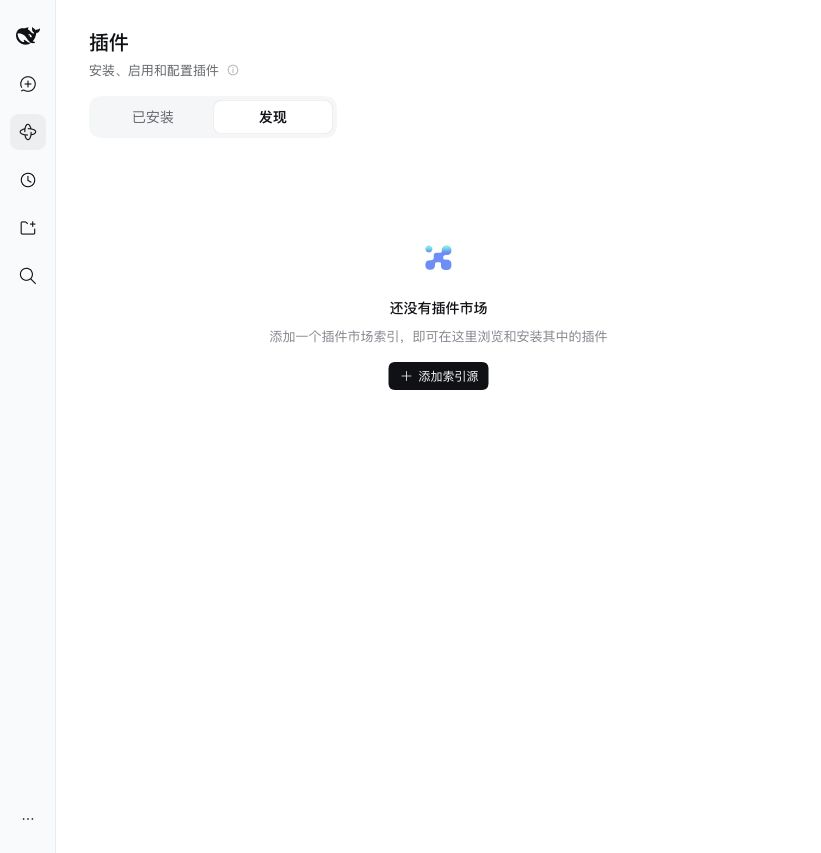

# 插件市场与发布准备

`0.1.0` 当前只做本地打包与验收，**尚未发布，也未上架任何索引**。公开仓库地址暂不指定；`repository`、`homepage`、`bugs` 和提交收录的目标留到正式发布前填写。不能把文档示例当作已存在的下载地址。

## DSH 的“插件广场”如何工作

调查日期：2026-10-26。这里区分两件事：

- **安装包的分发**：让用户获得可安装的 npm 包或本地 `.tgz`。
- **在发现页展示**：让 DSH 加载某个插件索引，索引条目指向确切版本的包或 Git 提交。

本机 DSH `0.2.1-rc.2` 中，进入「插件 → 实验性插件 → 更多」，可启用「自定义插件市场」，之后出现「已安装 / 发现」页。它默认没有索引地址，也没有一个统一的官方上架入口。新版上游文档把入口称为「自定义插件索引」；不要依名称差异误认为安装失败。[官方组合包说明](https://github.com/deepseek-ai/deepseek-harness/blob/master/packages/experimental/plugin-market-bundle/README.zh.md)。

因此，“发布到插件广场”通常是：**先发布安装包，再向选定的社区索引提交条目**，或提供自己的静态索引让用户添加。社区索引的审核与提交方式由各自维护者决定，DSH 的索引格式本身不是一个投稿 API。本次未选择社区索引，也没有提交申请。



## 仓库已经准备好的内容

| 文件 / 声明 | 用途 |
| --- | --- |
| `package.json` 中的 `dsh.manifestVersion`、`dsh.bundle.patch` | 让宿主识别组合包并装配组件 |
| `engines.node`、`engines.dsh`、宿主 peer dependencies | 声明安装约束和宿主共享依赖；范围不代替逐版本验收 |
| `cordis.patch.yml`、`lib/`、`prompts/`、公开 exports | 组成实际可运行安装包 |
| `locale/zh.json`、`locale/en.json` 和组件 locale | 中文名、英文名、功能介绍 |
| `icon.svg` 及根包 / 组件 icon exports | 插件列表和详情页图标 |
| `README.md`、`README_EN.md`、`docs/user-guide.md`、`docs/assets/` | 产品说明、图文安装配置及实际效果 |
| locale 中的 `meta.detail` | 为支持详细介绍的新宿主指定中英文 README |
| `LICENSE-MIT`、`LICENSE-APACHE`、`CHANGELOG.md` | 许可证和变更记录 |
| 锁文件、CI、安装与契约脚本 | 重建和验证交付物 |

DSH 官方打包指南要求可解析的组合 patch、引擎范围和运行产物，并要求宿主共享包通过 peer dependencies 引用。当前项目按此方式构建；安装测试会从实际 tarball 检查入口、资源和宿主引擎拒绝行为。[官方发布说明](https://github.com/deepseek-ai/deepseek-harness/blob/master/docs/user/develop/basic/publish.md)。

当前分发路线选用**预构建包**：先 `pnpm pack`，用户在网页安装 `.tgz`；未来可将验收过的同一包版本发布到 npm，再由索引引用。仓库地址用作展示与源码入口，**不等于已经支持 Git 源码直装**。本仓库不跟踪 `lib/`，目前没有 Git 安装用的 `prepare`；若以后选择 Git source，需另加构建生命周期、配置构建授权并验证直装，不能仅填仓库 URL 就声称可安装。

## 新版详细介绍与截图

上游最新文档支持 locale 的 `meta.detail`，其值为相对包根的 Markdown 路径。本文对应的设置是中文 `README.md`、英文 `README_EN.md`。文档引用的图片相对 Markdown 解析，因此图文资料必须一起打包，路径不能越出包根。[官方详细介绍规范](https://github.com/deepseek-ai/deepseek-harness/blob/master/packages/util/plugin-detail/README.zh.md)。

本机 `0.2.1-rc.2` 已验证名称、介绍、图标和 ACN 配置页；**没有把新版长文详情渲染记为本机通过**。`meta.detail` 及对应文件的包含性由安装包检查验证，升级到支持该特性的宿主后仍需实际打开详情并核对语言和图片。

## 索引条目需要什么

DSH format 1 索引由顶层 `format`、`title`、`plugins` 组成。条目使用稳定包名，版本记录包含精确版本、实际发布时间、来源和 `engines.dsh`。npm 来源指向 `name@version`；Git 来源需要 HTTPS 仓库地址与完整的 40 位提交哈希，不能使用浮动分支。标题和介绍可本地化，提供对象形式时应包含英文。[官方索引格式](https://github.com/deepseek-ai/deepseek-harness/blob/master/.agents/notes/implemented/feature/2026-10-02-plugin-market-index-format.zh.md)。

正式准备条目时，按以下内容填写；当前不生成伪装成可安装版本的 `index.json`：

| 条目内容 | 当前值 / 待办 |
| --- | --- |
| `name` | `dsh-plugin-acn`；发布前检查 registry 名称占用及维护权限 |
| `title` | `en: agent-claim-network`、`zh: ACN记忆框架` |
| `description` | 从包的中英文 locale 复制，保持与实际能力一致 |
| `icon` | 使用已发布、可访问的图标 URL，或符合索引大小限制的嵌入图标；包内 icon export 不自动成为远程索引 URL |
| `repository` / `homepage` | 待维护者确定公开地址后填写，当前省略 |
| `versions[].version` | 取最终发布包的精确版本；当前 `0.1.0` 仍未发布 |
| `publishTimestamp` | 实际发布时的 Unix 秒数，不能用打包时间冒充 |
| `source` | 本版计划 npm 精确版本；等包可公开获取后填写 |
| `engines.dsh` | 从该版本的最终 `package.json` 原样复制 |
| 分类、关键词、作者 | 根据目标索引规则填写真实且可公开的资料 |

## 发布前仍须完成

1. 确定公开仓库、源码主页、问题反馈地址和维护主体；补齐包元数据。
2. 确认 npm 包名归属、registry 和版本号，检查实际 tarball、许可证、截图与文档是否齐全。
3. 运行[完整验证](development.md)，并在最终目标宿主版本复验网页安装、配置和详情展示。
4. 配置 CI 的 `ACN_REFERENCE_REPOSITORY`；必要时通过 CI secret 提供 `ACN_REFERENCE_TOKEN`，不能写入仓库。远端 CI 目前尚未运行。
5. 由维护者执行正式发布，再用干净 DSH profile 从真实发布源安装一次。
6. 选择社区索引或自行托管索引，按其规则填写条目；添加该索引后验证发现、详情、兼容提示和安装。

本次不执行第 5、6 步，也不推送 Git 或创建远端 Release。没有公开仓库与真实发布版本前，上述条目保持待填状态。

## 公开资料与提交身份

保留许可证中的公司版权署名。使用说明和截图只展示通用配置与合成项目，不包含本机提供商别名、实际数据路径、邮箱或凭据。历史验收中的模型名称和结论保留，供应端名称省略；含本机路径的旧截图已移除，用户指南采用重新采集的界面局部截图。

本仓库在公开整理时重新初始化 Git，不保留原有提交、分支、reflog 或历史备份。`docs/validation/` 中的旧提交号仅标识当次验收基线，不再对应本仓库可访问的历史；参考 ACN 仓库的版本和契约基线不受影响。

维护者在本仓库使用公开署名和空邮箱，避免继承全局身份：

```sh
git config --local user.name "ACN contributors"
git config --local user.email ""
git config --local user.useConfigOnly true
```

`pnpm check:security` 检查当前文本中的凭据、邮箱、个人路径及可达提交邮箱。它不识别图片文字，也不替代完整历史和安装包扫描；更新截图后仍需人工查看及 OCR 复核。分发使用经过检查的安装包或 Git 内容，不直接压缩含依赖缓存和本地日志的开发目录。

## 本地包与验证入口

```sh
pnpm install --frozen-lockfile
pnpm typecheck
pnpm lint
pnpm check:security
pnpm check:docs
pnpm test
ACN_REPO=/path/to/reference pnpm test:compat
ACN_REPO=/path/to/reference pnpm test:contract
pnpm build
pnpm pack --pack-destination .artifacts
pnpm smoke:install
```

`smoke:install` 使用新的 `DSH_HOME`，不修改日常 profile；检查实际 tarball 的模块、双语介绍、图标、截图与文档路径，以及不兼容版本拒绝。Web、团队、模型和故障复验脚本见[开发与复验](development.md)。本次结果见[图文说明与发布准备验收](validation/2026-10-26-documentation-release.md)，现有限制见[已知兼容限制](outstanding-issues.md)。
