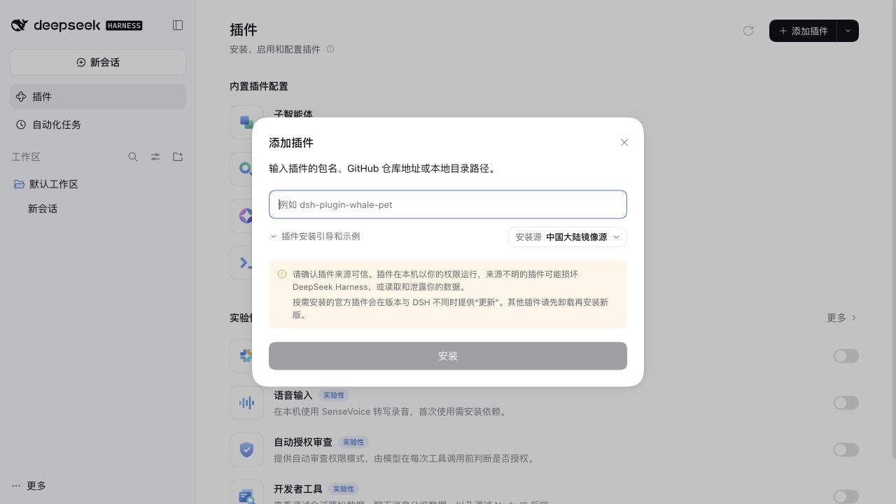
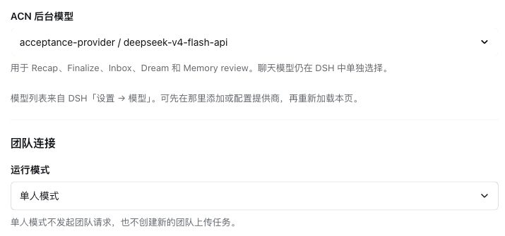
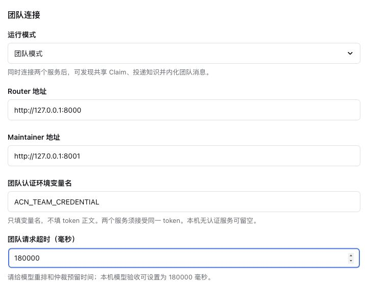

# 使用指南

ACN记忆框架帮助 DSH 保留可以复用的工作经验。第一次使用，建议先在单人模式走完“完成工作 → 形成知识 → 新会话复用”，再连接团队服务。

本文以 DSH `0.2.1-rc.2` 的网页界面为例。截图展示安装入口和配置控件；实际使用时，请选择自己的模型和长期保留的知识目录。

## 1. 在网页安装

当前版本尚未公开发布，先从源码构建本地安装包。在插件项目目录运行：

```sh
pnpm install --frozen-lockfile
pnpm pack --pack-destination .artifacts
```

需要 Node `^22.19.0 || >=24.0.0` 和 pnpm `11.25.0`。若已拿到可信的预构建 `.tgz`，不需要重复构建。

1. 启动 `dsh` 并打开它提供的网页。
2. 进入左侧「插件」，展开「添加插件」右侧的下拉菜单，选择「安装第三方插件」。
3. 填入 `dsh-plugin-acn-0.1.0.tgz` 在 **DSH 主机上的绝对路径**，点击「安装」。例如 `/path/to/dsh-plugin-acn/.artifacts/dsh-plugin-acn-0.1.0.tgz`。
4. 安装完成后点击「立即启用」，再打开「ACN记忆框架」。



这是本地路径安装，不是上传浏览器所在电脑的文件。远程运行 DSH 时，安装包必须位于远程主机。安装只提供组件；填写 Agent ID 并保存后才启用知识存储。

## 2. 配置身份、目录与模型


| 字段 | 个人使用怎么填 | 团队使用有什么不同 |
| --- | --- | --- |
| Agent ID | 自取固定名称，如 `personal`；只用小写字母、数字、下划线或连字符 | 每位成员使用稳定且唯一的 ID，并与服务端授权一致 |
| 知识目录 | 建议保留 `~/.acn-dsh`；数据实际位于 `agents/<agentId>/` 下 | 不同成员使用独立的 `agents/<agentId>/`；可在同一数据根下使用不同 ID |
| ACN 后台模型 | 选已注册的模型，例如 `deepseek-v4-flash-api` | 该选项只配置插件，不替 Router / Maintainer 配置模型 |
| 运行模式 | 选择「单人模式」 | 准备好两项团队服务后再选择「团队模式」 |

**Agent ID 不是项目 ID。** 同一知识目录和 ID 下，所有项目与会话共用知识和私有记忆。个人模式可任意取一个合法名称，但设好后建议保持稳定。需要互不相通的知识空间时，用独立的 DSH 配置和不同 ID 或目录。



后台模型用于 Recap、Finalize、Inbox、Dream 和 Memory review。聊天输入框旁的模型选择器属于 DSH，需单独选择。要统一用 `deepseek-v4-flash-api`，两处都选这个模型。

如果列表中没有它，先在 DSH「设置 → 模型」配置提供商、模型 ID 和凭据，再回到插件页重新加载。ACN 复用宿主模型配置，不需要再保存一份模型密钥。提供商名称取决于自己的 DSH 配置。

完成后点击 **保存并应用**，看到“已保存并应用”后新建会话。修改字段不会自动生效；“有未保存的更改”表示仍是草稿。

「重新加载已保存配置」适用于放弃草稿、读取另一窗口已保存的值，或刷新模型列表。它**将丢弃未保存的修改**，不会重跑知识任务或删除已有知识。

修改 ID 或目录只切换存储，不迁移数据；旧会话不能改用新身份，需新建会话。模型与团队参数修改会保留现有会话的冻结快照。全部参数见[配置说明](config.md)。

## 3. 完成一次知识形成与复用

先在 DSH 选择实际项目工作区，再新建会话。启动 DSH 时的目录不一定就是网页当前工作区。

1. 输入 `/acn-status`，确认身份、数据目录与模式正确。
2. 正常让 Agent 完成一项工作，例如修复缺陷、实现功能、核对接口约定。尽量让结果包含适用版本、验证方法和未验证范围。
3. 工作完成后输入 `/acn-finalize`。它会返回后台任务 ID，不会立即显示全部知识。
4. 再用 `/acn-status` 查看任务；成功后输入 `/claim` 列出知识，`/claim show <id>` 查看一条知识的完整正文、范围、证据与置信度。把 `<id>` 换成列表中的实际 ID。
5. 新建会话，让 Agent 先检索相关 Claim，再解决相似问题。核对它是否实际调用了 `claim` 工具，以及引用的范围是否适用于新任务。

可以这样发起第二次工作：

> 先查阅已有的读取重试相关 Claim，列出适用范围和证据限制，再根据当前项目判断能否采用。不要把旧项目中的规则直接视为当前项目的事实。

**Claim** 是一条可复用的知识，不是整段聊天记录；**Trace** 记录形成或使用知识的来源。一次成功的 Finalize 可能没有新增 Claim，例如没有新的可复用经验，或只是确认已有结论。任务成功表示流程完成，不等于知识一定正确。

平时还会在空闲 30 分钟、会话释放或重启恢复时收尾。Recap 在宿主成功压缩上下文后处理被压缩的区间；兼容基线中的 DSH Web 模板默认未启用压缩，需按[说明](config.md#宿主压缩与-recap)配置。手动 Finalize 不依赖压缩。

## 4. 私有 Memory

Claim 适合带范围和依据的工作知识；私有 Memory 适合持续有用的个人经验和偏好。可以对 Agent 说：

> 请使用 memory 工具记住：给我说明测试结果时，区分已验证项与未验证项。

插件维护 `MEMORY.md` 与 `USER.md`，并通过专门工具添加、替换和删除条目。新会话读取新的快照；已打开、恢复或压缩的会话继续使用原快照，因此修改后需要新建会话观察效果。

两份文件不会被直接转成 Claim 或上传团队服务。自动 Memory review 会使用已配置的模型处理私有输入，所以这里的“私有”指与团队知识隔离，并不意味着离线运行。长期编码回合的有界窗口可能不满足自动 review 条件；显式 `memory` 工具仍可使用。[完整边界](command-reference.md#私有-memory)。

## 5. 用 Dream 整理知识

积累知识后输入 `/dream`，再用 `/acn-status` 查看任务。Dream 可以清理一次性记录、整合同主题知识，并保留被废弃知识的历史。没有安全的改进时，也可以保留原样。

默认自动运行需要同时满足冷却时间和知识变化数量；手动 `/dream` 可跳过这些门槛。`/dream stop` 请求暂停，已进入固定提交阶段的组会先完成；再次 `/dream` 继续。失败任务使用 `/acn-status retry <job_id>`。

插件要求修改保留完整原证据摘要及来源限制，但这不能证明模型的解释完全正确。重要规则整理后仍应检查适用版本、例外和未验证范围。报告保存在 Agent 数据目录的 `dream/<job_id>/report.md`。

### Dream 证据校准

工作区文件查证默认关闭，当前需在[高级配置](config.md)中设置 `dream.evidenceCalibration: true`。它只允许受限的只读文件工具与 Claim 查询，不提供任意命令或联网搜索；不会读取私有双文件。高置信度 Claim 不进入证据校准。[详细规则](command-reference.md#dream-证据校准)。

## 6. 接入团队

团队模式需要另外部署 **ACN Router 和 Maintainer**。插件负责连接与知识内化，不负责启动服务器，也不自动分派多 Agent 编码任务。多个成员可以各自在 DSH 工作，共用同一团队服务。

先由团队维护者准备：两项可达的服务地址、每名成员的唯一 Agent ID、匹配该身份的认证凭据。将凭据放入启动 DSH 的环境变量，例如 `ACN_TEAM_CREDENTIAL`；页面只填这个变量名，不填密钥正文。



图中地址是**未保存的填写示例**，不是正在运行的团队。实际端口由部署决定。为每位成员填好自己的身份、两个 endpoint 和认证变量名，然后保存、新建会话。

建议按以下顺序检查：

| 操作 | 应观察到什么 |
| --- | --- |
| `/acn-status` | 身份正确；两项服务各自显示状态；保存成功本身不证明服务可达 |
| 让 Agent 用 `consult_router` 查看概览，再查询具体主题 | 返回可引用的候选 Claim；新团队可能为空，不要把空结果当成连接失败 |
| 成员 A 完成工作并 `/acn-finalize` | 形成知识后进入上传队列；网络正常时投递完成 |
| 成员 B 新会话查询相同主题 | 能发现 A 的共享知识，判断适用性后使用并形成自己的经验 |
| 存在真实冲突时记录不同结论及证据 | 有效 Dispute 送至 Maintainer；自动仲裁需服务端另外启用 |
| 各成员运行 `/inbox`，再看 `/acn-status` | 收到的建议先持久化，再经模型内化；成功内化才改变本地 Claim，并按规则回传 |
| 执行 `/dream` 后再次查询 | 检查存续知识、废弃历史及团队投递，没有把过时版本重新发布 |

Router 的作用是检索；Maintainer 的作用是管理建议与争议；本地 Agent 决定如何内化。它们不能直接修改成员私有 Memory。仲裁结果也不等于每位成员马上发生相同的正文修改。

**当前推荐 Router 使用词法检索，不启用 LLM 重排。** 模型重排可能让相同查询的候选集合变化，触发 Maintainer 的输入变化保护，阻止自动采纳。关闭 Router 重排不影响 DSH 插件和 Maintainer 使用模型；它们的模型分别配置。完整说明见[团队仲裁与信息边界](outstanding-issues.md#团队仲裁与信息边界)。

`consult_router` 能返回关联争议及已解决 ID，但不提供完整裁决正文或仲裁内部阶段；需要这些信息时查看 Maintainer 管理接口或记录。

共享经验仍需结合当前代码、测试和业务决策判断。使用 Claim 前检查适用范围、证据摘要和置信度；发现冲突时保留不同结论的依据，再交给团队处理，不要把已有知识当作不可修改的事实。

## 7. 常用命令与排障

| 命令 | 场景 |
| --- | --- |
| `/acn-status` | 查看身份、数量、连接状态和最近后台任务 |
| `/claim`、`/claim show <id>` | 浏览与核对知识 |
| `/acn-finalize` | 主动收尾当前工作轨迹 |
| `/inbox` | 拉取并排队内化团队建议 |
| `/dream`、`/dream stop` | 开始、继续或暂停知识整理 |
| `/acn-status retry <job_id>` | 修正失败原因后重试任务 |
| `/acn-import --dry-run <acn_agent_home>` | 预览已有 ACN 数据的只读迁移 |

这些斜杠命令不会作为普通消息发给模型。工具参数、修订和导入边界见[命令参考](command-reference.md)。

| 现象 | 处理方式 |
| --- | --- |
| 只有 `/acn-status`，没有知识工具 | 确认 ACN 已启用、Agent ID 已保存，并新建会话 |
| 保存提示忙碌或版本冲突 | 先结束正在运行的 Agent；冲突时重读已保存配置后再编辑 |
| 旧会话提示身份不匹配 | 身份、目录发生过变化，或旧版没有记录绑定；保留旧记录，使用新会话 |
| 任务 queued / running，暂时没新知识 | 等待实际处理，用状态查看进度；不要重复创建同一任务 |
| 任务 failed | 核对模型路由、凭据和错误类别，修正后按任务 ID 重试；严格校验失败不会把无效草稿当作成功 |
| 单人模式 `/inbox` 没有团队消息 | 正常；单人模式不联系团队，也不为未来自动积攒上传队列 |
| 团队待上传数量不归零 | 检查两个服务、认证、版本与整合依赖；服务恢复后可用 `/inbox` 触发补传 |
| Memory 已更新但当前对话没用到 | 当前会话快照固定，新建会话验证 |
| 文件编辑提示“尚未读取” | 这是 DSH 文件工具规则，先通过它的读取工具读文件；ACN 不接管宿主文件工具 |

数据默认位于 `~/.acn-dsh/agents/<agentId>/`。升级前备份该目录；不要与原生 ACN 共用活动数据目录。卸载插件不会替你迁移或清理知识。完整限制见[已知兼容限制](outstanding-issues.md)。
