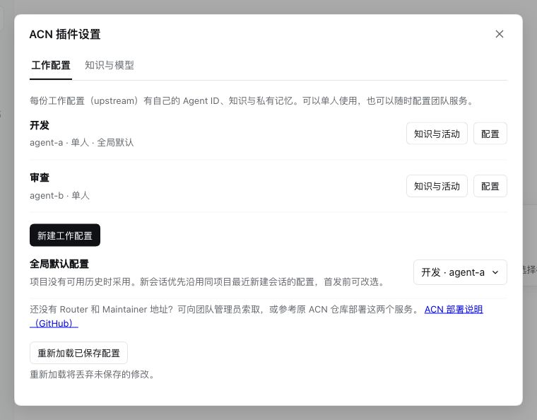
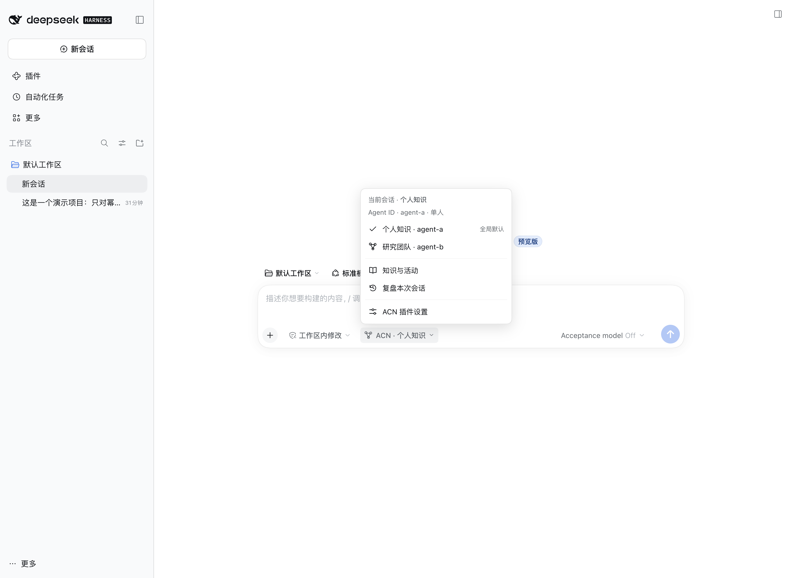
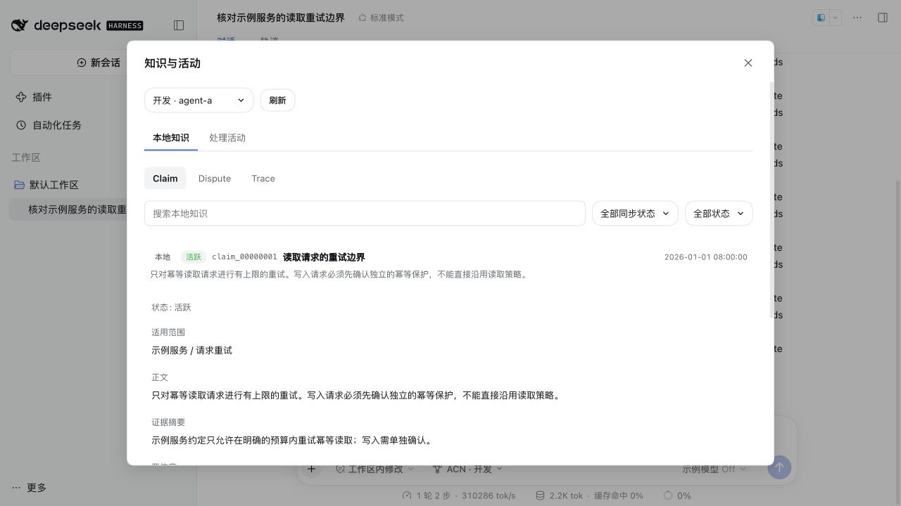
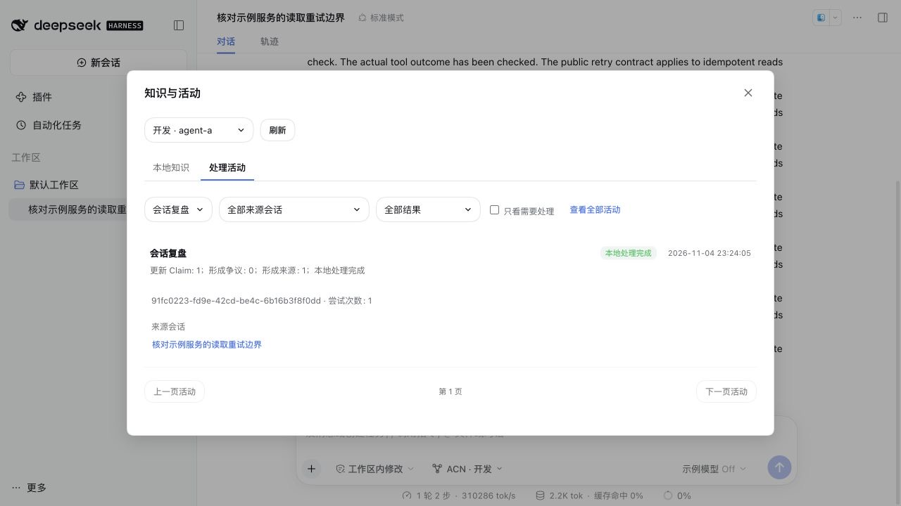
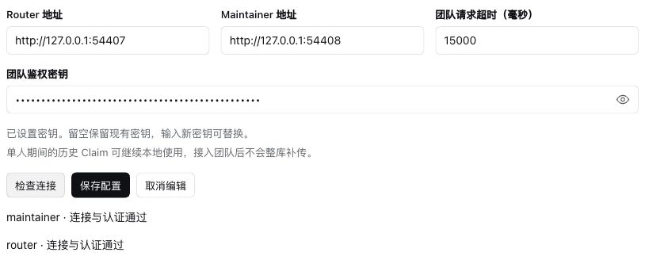
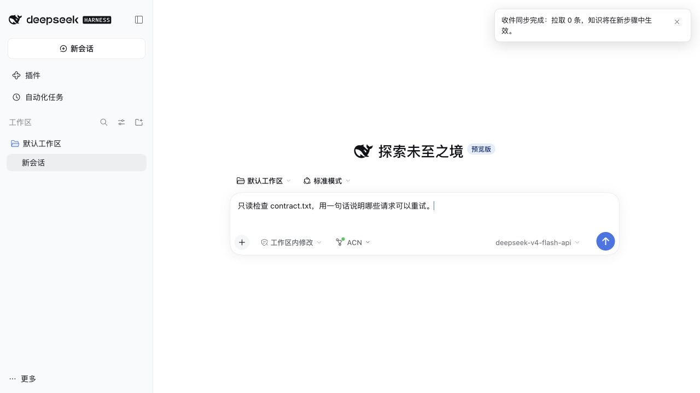

# 使用指南

ACN记忆框架帮助 DSH 保留可以复用的工作经验。第一次使用，建议先在单人模式走完“完成工作 → 形成知识 → 新会话复用”，再连接团队服务。

本文以 DSH `0.2.1-rc.2` 的网页界面为例。截图展示安装入口和配置控件；实际使用时，请选择自己的模型和长期保留的知识目录。

## 1. 在网页安装

当前版本尚未公开发布，先从源码构建本地安装包。在插件项目目录运行：

```sh
pnpm install --frozen-lockfile
pnpm pack --pack-destination .artifacts
```

需要 Node `^22.19.0 || >=24.0.0` 和 pnpm `11.25.0`。若已拿到可信的预构建 `.tgz`，不需要重复构建。

1. 启动 `dsh` 并打开它提供的网页。
2. 进入左侧「插件」，展开「添加插件」右侧的下拉菜单，选择「安装第三方插件」。
3. 填入 `dsh-plugin-acn-0.1.0.tgz` 在 **DSH 主机上的绝对路径**，点击「安装」。例如 `/path/to/dsh-plugin-acn/.artifacts/dsh-plugin-acn-0.1.0.tgz`。
4. 安装完成后点击「立即启用」，再打开「ACN记忆框架」。


这是本地路径安装，不是上传浏览器所在电脑的文件。远程运行 DSH 时，安装包必须位于远程主机。安装只提供组件；填写 Agent ID 并保存后才启用知识存储。

## 2. 配置个人身份、团队与模型

打开 DSH「设置 → ACN 插件设置」，或在「插件」中选择「ACN记忆框架」。聊天框的 **ACN → ACN 插件设置** 也能打开同样的表单。



在「工作配置」点击「新建工作配置」，填写 Agent ID，例如 `coding`。显示名称可选，保存后首份配置会成为全局默认。每份配置都能单人使用，以后也能在原配置上开启团队服务，沿用同一个 Agent ID。需要隔离知识时创建另一份配置。

知识按 upstream 与 Agent ID 确定归属。同一份配置下的多个项目共享 Claim 和私有 Memory；不同配置各自独立。新会话自动沿用同项目最近新建的普通会话所选配置；没有可确认的记录，或最近配置已停用、删除、改变身份时，使用全局默认。没有可用全局默认时，需要在聊天框的 ACN 菜单中明确选择。

首次配置后，如果宿主仍显示配置前的空白会话，可在 ACN 菜单点击所需配置完成初始化，无需反复新建会话。已经发送消息、发起模型请求的会话和历史派生会话不能重新选择身份。

首发前仍可在 ACN 菜单改选，首发后归属固定。旧会话继续聊天或重新打开不会改变项目的预选顺序；内部子代理不参与选择。已有会话和草稿不会因为后来新建会话而改绑。此功能使用 DSH 公开的会话接口，正常安装插件即可使用，无需额外兼容扩展或项目默认设置。



切换到「知识与模型」，选择「知识处理模型」。列表来自 DSH「设置 → 模型」，检查成功后自动保存；失败或取消保留原值。该模型用于 Recap、Finalize、Inbox、Dream 和 Memory review，聊天输入框旁的模型单独选择。两处均可使用 `deepseek-v4-flash-api`。选择「沿用会话模型」时，后台任务使用同一配置下持久保存的会话路由。

这一页也可以设置所有配置的知识根目录和结果提示。默认根目录为 `~/.acn-dsh`；修改目录不会搬迁旧数据。模型或偏好单独保存，不提交其他表单的草稿。「重新加载已保存配置」用于放弃草稿或读取另一窗口的修改，**会丢弃未保存的修改**。

保存服务地址后，新启动的运行实例使用新连接，运行中的会话保持原客户端。修改 Agent ID 或目录会使用另一份存储，原数据保留。旧会话不能因此改绑到另一身份。完整字段和升级规则见[配置说明](config.md)。


## 3. 完成一次知识形成与复用

先在 DSH 选择实际项目工作区，再新建会话。启动 DSH 时的目录不一定就是网页当前工作区。

1. 输入 `/acn-status`，确认身份、数据目录与模式正确。
2. 正常让 Agent 完成一项工作，例如修复缺陷、实现功能、核对接口约定。尽量让结果包含适用版本、验证方法和未验证范围。
3. 有已验证的工作成果后输入 `/recap`，主动提炼这次新增经验。它会返回后台任务 ID；没有可处理的新增内容时会提示，不创建空任务。
4. 打开聊天框中的「ACN → 知识与活动」，在「处理活动」查看状态，在「本地知识」展开 Claim 阅读正文、范围、证据与置信度。也可用 `/acn-status`、`/claim` 和 `/claim show <id>`。
5. 新建会话，让 Agent 先检索相关 Claim，再解决相似问题。核对它是否实际调用了 `claim` 工具，以及引用的范围是否适用于新任务。

也可从聊天框的 ACN 菜单点击「复盘本次会话」，作用与 `/recap` 相同。首发后菜单显示固定的知识归属；更换团队需要新建会话。



知识页可切换身份、搜索名称或正文、查看 Claim / Dispute / Trace，并沿来源 Claim 继续查阅。来源详情提供返回入口，保留原详情与筛选；来源不在当前配置的本地库中时，显示来源 ID 和缺失说明。浏览和刷新只读本地数据，不触发同步、团队查询或模型。活动页显示任务结果、失败原因、来源会话和重试入口；先修正失败原因再重试。显示“本地处理完成”与“团队投递完成”是两个阶段，待投递数量需单独查看。



结果只在来源会话、页面可见且窗口有焦点时短暂显示；查看其他会话或知识弹窗时不会打断操作。已显示结果会持久记账，重启后不会反复弹出旧结果。没有提示不代表任务失败，应以活动页为准。

可以这样发起第二次工作：

> 先查阅已有的读取重试相关 Claim，列出适用范围和证据限制，再根据当前项目判断能否采用。不要把旧项目中的规则直接视为当前项目的事实。

**Claim** 是一条可复用的知识，不是整段聊天记录；**Trace** 记录形成或使用知识的来源。一次成功的 Recap 或 Finalize 可能没有新增 Claim，例如没有新的可复用经验，或只是确认已有结论。任务成功表示流程完成，不等于知识一定正确。

### 手动复盘与收尾

工作中途或完成一个小阶段后，用 `/recap` 复盘新增内容；它不要求达到自动触发门槛。若前台仍在执行，只提交此前已经完成的安全范围。需要主动收尾时也可用 `/acn-finalize`，它本身不会归档会话或开启归档暂停。

### 自动复盘与归档

单人和团队模式都按尚未处理的增量自动复盘：完成 10 轮人工交互或约 10 万估算 token 后空闲至少 5 分钟，或者少量内容空闲至少 1 小时。插件每 30 秒检查一次，并在前台任务结束时检查；需模型可用且当前会话没有正在运行的前台任务。查看历史和切换页面不会重置计时。

在 DSH 归档会话时，插件按当时的范围执行 Finalize 并暂停自动复盘；迟到结果不扩大这次范围。撤销归档后，需真正发送消息继续会话才恢复自动复盘。结果可用 `/acn-status` 查看。

宿主成功压缩上下文也会对被压缩区间触发 Recap。兼容基线中的 DSH Web 模板默认未启用压缩，需按[说明](config.md#宿主压缩与-recap)配置；`/recap` 和 `/acn-finalize` 都可独立使用。完整规则见[知识形成与失败重试](command-reference.md#知识形成与失败重试)。

## 4. 私有 Memory

Claim 适合带范围和依据的工作知识；私有 Memory 适合持续有用的个人经验和偏好。可以对 Agent 说：

> 请使用 memory 工具记住：给我说明测试结果时，区分已验证项与未验证项。

插件维护 `MEMORY.md` 与 `USER.md`，并通过专门工具添加、替换和删除条目。新会话读取新的快照；已打开、恢复或压缩的会话继续使用原快照，因此修改后需要新建会话观察效果。

两份文件不会被直接转成 Claim 或上传团队服务。自动 Memory review 会使用已配置的模型处理私有输入，所以这里的“私有”指与团队知识隔离，并不意味着离线运行。长期编码回合的有界窗口可能不满足自动 review 条件；显式 `memory` 工具仍可使用。[完整边界](command-reference.md#私有-memory)。

## 5. 用 Dream 整理知识

积累知识后输入 `/dream`，再用 `/acn-status` 查看任务。Dream 可以清理一次性记录、整合同主题知识，并保留被废弃知识的历史。没有安全的改进时，也可以保留原样。

默认自动运行需要同时满足冷却时间和知识变化数量；手动 `/dream` 可跳过这些门槛。`/dream stop` 请求暂停，已进入固定提交阶段的组会先完成；再次 `/dream` 继续。失败任务使用 `/acn-status retry <job_id>`。

Dream 在独立的 DSH 子会话中自主选择整理与查证步骤，逐组校验、自复核后提交。它要求保留有效条件、例外、版本和证据限制，采用逐 Claim 语义复核，不要求逐字复制整份摘要；这不能证明模型的解释完全正确。重要规则整理后仍应检查适用版本、例外和未验证范围。报告保存在 Agent 数据目录的 `dream/<job_id>/report.md`。

后台知识提交与编码同时进行时，增量知识通知如遇忙碌会暂缓，继续使用本会话的冻结目录，后续步骤再补发。主动读取或修改 Claim 仍会检查一致性；若工具返回 `knowledge_busy`，等待提交完成后重试即可。

每次 Dream 默认有 24 次探索模型请求，耗尽后额外最多 3 次收尾请求，总计最多 27 次；工具反馈和失败重试均计次。收尾只处理已有事项，不再发现候选或读取新证据。未完成项会明确记录，未提交草稿不生效；本次结束后，再次 `/dream` 会重新读取当前 Claim 开始新任务。高级配置 `dream.maxModelSteps`（1–128）和 `dream.maxWrapUpSteps`（1–8）可调整这两个额度。每次请求的默认输出上限仍为 32768 token。

如果宿主明确报告模型工具参数不是合法 JSON，插件会在重试前向模型说明解析失败、该次响应的工具调用均未执行，并要求重新发出合法参数。本次 Dream 最多自动额外重试两次，仍计入上述额度；坏参数不会执行。仍失败时，活动页会显示「工具参数格式无效（MALFORMED_RESPONSE）」和恢复建议，已接受的草稿、进度与已用额度保留。可稍后重试该任务或更换知识处理模型；合法 JSON 仍须通过原有字段、版本与证据校验。

### Dream 证据校准

工作区文件查证默认关闭，当前需在[高级配置](config.md)中设置 `dream.evidenceCalibration: true`。它只允许受限的只读文件工具与 Claim 查询，不提供任意命令或联网搜索；不会读取私有双文件。高置信度 Claim 不进入证据校准。[详细规则](command-reference.md#dream-证据校准)。

## 6. 接入团队

团队模式需要 **ACN Router 和 Maintainer**。多个成员可以各自在 DSH 工作，共用一套团队服务。插件负责连接与知识内化，不负责启动服务器，也不自动分派多 Agent 编码任务。

如果还没有这两项服务的地址，可以向团队管理员索取，也可以按原仓库 README 中的「部署 Router 与 Maintainer」自行部署。DSH 的「ACN 插件设置 → 工作配置」也提供这个入口，填写地址时可以在新标签页查阅。[ACN 部署说明（GitHub）](https://github.com/FTShare-Lab/agent-claim-network)

先由团队维护者准备：两项可达的服务地址、每名成员的唯一 Agent ID、匹配该身份的认证凭据。服务管理台仅供管理员使用，成员凭据不能代替管理员登录。

在「团队鉴权密钥」直接粘贴团队管理员提供的 key，默认以圆点显示，点击右侧眼睛按钮可显示或隐藏本次输入。点击「保存配置」会一并保存密钥，由 DSH 托管；内部引用名自动生成，无需填写。重新打开配置时只显示“已设置”状态，留空保留原密钥，输入新 key 可替换。已保存的密钥不会回传浏览器。

「检查连接」可直接验证本次输入，不会保存密钥或修改配置。如果密钥已保存但配置保存发生冲突，页面会明确提示两者的结果。旧的环境变量引用继续兼容；多个旧配置共用同名引用时，替换密钥会影响它们的下一次请求。应用启动后另开终端 `export` 不会更新已运行的桌面应用。

关闭团队连接后，原密钥引用仍保留，新启动的单人实例不会发起团队请求。重新启用团队并填写服务地址后可继续使用原密钥。托管存储只读或暂不可用时，仍可输入临时密钥检查连接；取消检查会中止后台请求。

在「ACN 插件设置 → 工作配置」新建或打开已有配置，开启「连接团队服务」，填写 Router、Maintainer 地址和团队鉴权密钥。Agent ID 沿用这份配置已有的身份。点击「检查连接」分别检查服务和认证，也可先离线保存。未启用团队鉴权的本机服务可留空密钥。



一份配置既可以单人使用，也可以接入团队。新会话优先沿用同项目最近新建会话的配置，没有可用记录时采用全局默认；首发前可在 ACN 菜单中改选。首发后归属固定；不同配置的本地知识与私有 Memory 相互隔离，同一配置的不同项目可以复用知识。



团队连接失败时保留所选身份，提示重试或检查设置，允许继续用本地知识工作。同步结果在聊天框外显示。仅浏览知识、设置和历史不会拉取消息或调用模型。单人不发团队请求，`/inbox` 仍能处理本地已经收到的消息。

给原单人配置接入团队后，原知识仍可使用，单人历史不会整库补传。修改已接入团队的服务地址会保留知识及待投队列，仍符合重试条件的记录可能送到新地址。需要把不同团队的本地资料分开时，应新建工作配置。停用会暂停关联会话的聊天和知识处理，已有知识仍可浏览；界面保留配置标识和数据，使用同一配置的「恢复」即可继续旧会话。详见[配置与升级说明](config.md)。

建议按以下顺序检查：

| 操作 | 应观察到什么 |
| --- | --- |
| `/acn-status` | 身份正确；两项服务各自显示状态；保存成功本身不证明服务可达 |
| 让 Agent 用 `consult_router` 查看概览，再查询具体主题 | 返回可引用的候选 Claim；新团队可能为空，不要把空结果当成连接失败 |
| 成员 A 完成一项工作并 `/recap` | 形成知识后进入上传队列；网络正常时投递完成 |
| 成员 B 新会话查询相同主题 | 能发现 A 的共享知识，判断适用性后使用并形成自己的经验 |
| 存在真实冲突时记录不同结论及证据 | 有效 Dispute 送至 Maintainer；自动仲裁需服务端另外启用 |
| 各成员运行 `/inbox`，再看 `/acn-status` | 收到的建议先持久化，再经模型内化；成功内化才改变本地 Claim，并按规则回传 |
| 执行 `/dream` 后再次查询 | 检查存续知识、废弃历史及团队投递，没有把过时版本重新发布 |

Router 的作用是检索；Maintainer 的作用是管理建议与争议；本地 Agent 决定如何内化。它们不能直接修改成员私有 Memory。仲裁结果也不等于每位成员马上发生相同的正文修改。

**当前推荐 Router 使用词法检索，不启用 LLM 重排。** 模型重排可能让相同查询的候选集合变化，触发 Maintainer 的输入变化保护，阻止自动采纳。关闭 Router 重排不影响 DSH 插件和 Maintainer 使用模型；它们的模型分别配置。完整说明见[团队仲裁与信息边界](outstanding-issues.md#团队仲裁与信息边界)。

`consult_router` 能返回关联争议及已解决 ID，但不提供完整裁决正文或仲裁内部阶段；需要这些信息时查看 Maintainer 管理接口或记录。

共享经验仍需结合当前代码、测试和业务决策判断。使用 Claim 前检查适用范围、证据摘要和置信度；发现冲突时保留不同结论的依据，再交给团队处理，不要把已有知识当作不可修改的事实。

## 7. 常用命令与排障

| 命令 | 场景 |
| --- | --- |
| `/acn-status` | 查看身份、数量、连接状态和最近后台任务 |
| `/claim`、`/claim show <id>` | 浏览与核对知识 |
| `/recap` | 主动复盘新增内容，不要求达到自动触发门槛 |
| `/acn-finalize` | 主动收尾当前工作轨迹，不等同于归档会话 |
| `/inbox` | 拉取并排队内化团队建议 |
| `/dream`、`/dream stop` | 开始、继续或暂停知识整理 |
| `/acn-status retry <job_id>` | 修正失败原因后重试任务 |
| `/acn-import --dry-run <acn_agent_home>` | 预览已有 ACN 数据的只读迁移 |

这些斜杠命令不会作为普通消息发给模型。工具参数、修订和导入边界见[命令参考](command-reference.md)。

| 现象 | 处理方式 |
| --- | --- |
| 只有 `/acn-status`，没有知识工具 | 确认 ACN 已启用、Agent ID 已保存，并新建会话 |
| 保存提示忙碌或版本冲突 | 先结束正在运行的 Agent；冲突时重读已保存配置后再编辑 |
| 旧会话提示身份不匹配 | 身份、目录发生过变化，或旧版没有记录绑定；保留旧记录，使用新会话 |
| 任务 queued / running，暂时没新知识 | 等待实际处理，用状态查看进度；不要重复创建同一任务 |
| 空闲后没有自动 Recap | 检查是否有未处理内容、是否达到批量或尾部门槛，以及后台模型是否可用；前台运行期间不会自动入队 |
| 撤销归档后仍不自动复盘 | 正常；查看历史不会恢复自动触发，真正发送消息继续会话后才恢复 |
| 任务 failed | 展开处理活动查看原因：鉴权、额度、上下文、输出上限或响应格式；修正后按任务 ID 重试，详见[失败分类与恢复](command-reference.md#知识形成与失败重试) |
| 单人模式 `/inbox` 没有团队消息 | 正常；单人模式不联系团队，也不为未来自动积攒上传队列 |
| 团队待上传数量不归零 | 检查两个服务、认证、版本与整合依赖；服务恢复后可用 `/inbox` 触发补传 |
| Memory 已更新但当前对话没用到 | 当前会话快照固定，新建会话验证 |
| 文件编辑提示“尚未读取” | 这是 DSH 文件工具规则，先通过它的读取工具读文件；ACN 不接管宿主文件工具 |

数据默认位于 `~/.acn-dsh/agents/<agentId>/`。升级前备份该目录；不要与原生 ACN 共用活动数据目录。卸载插件不会替你迁移或清理知识。完整限制见[已知兼容限制](outstanding-issues.md)。
