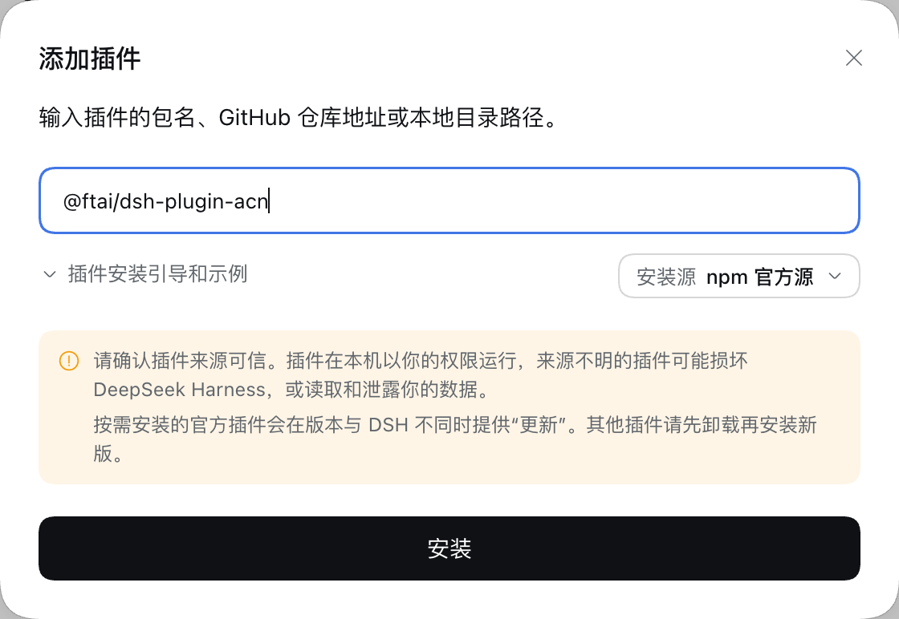
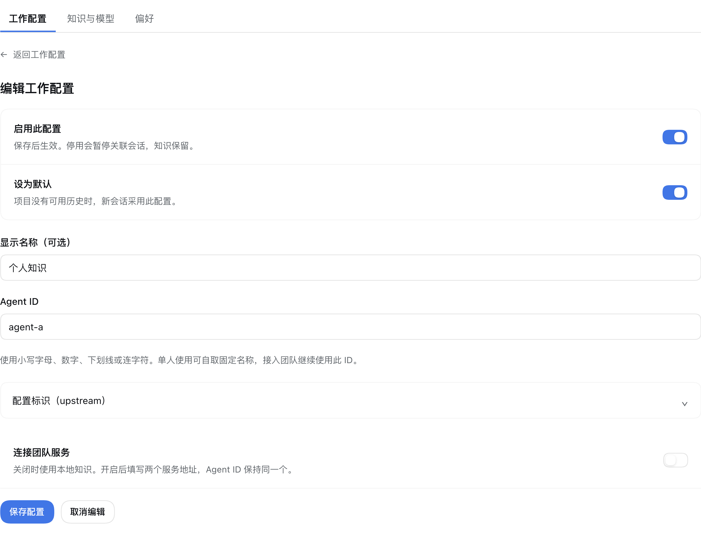
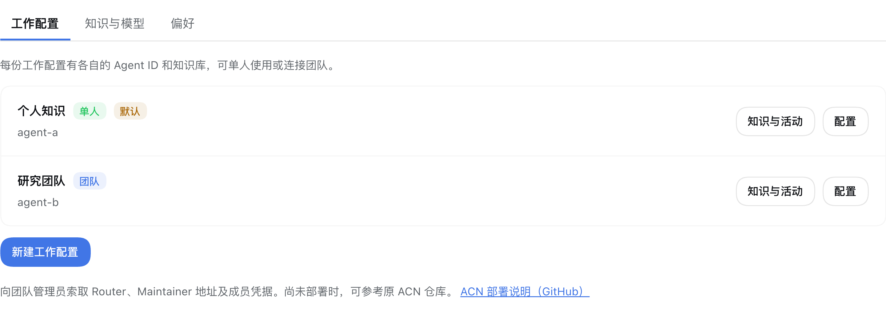
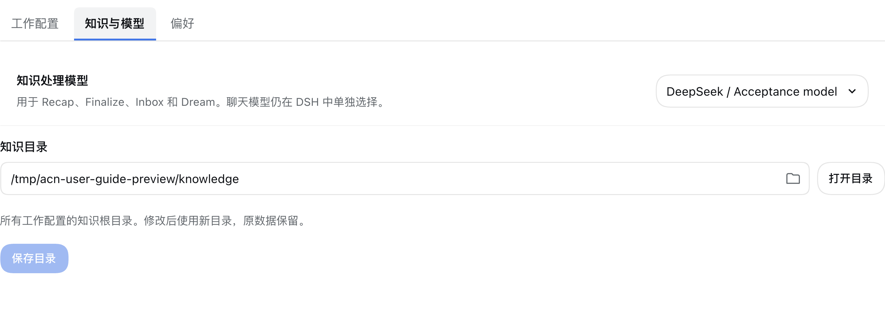
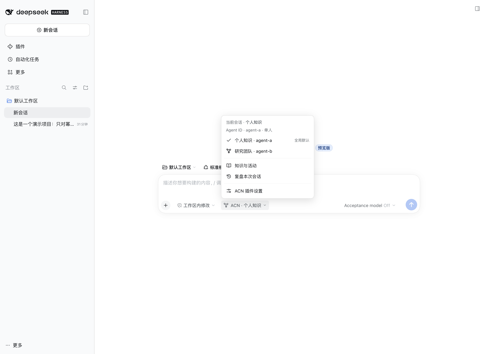
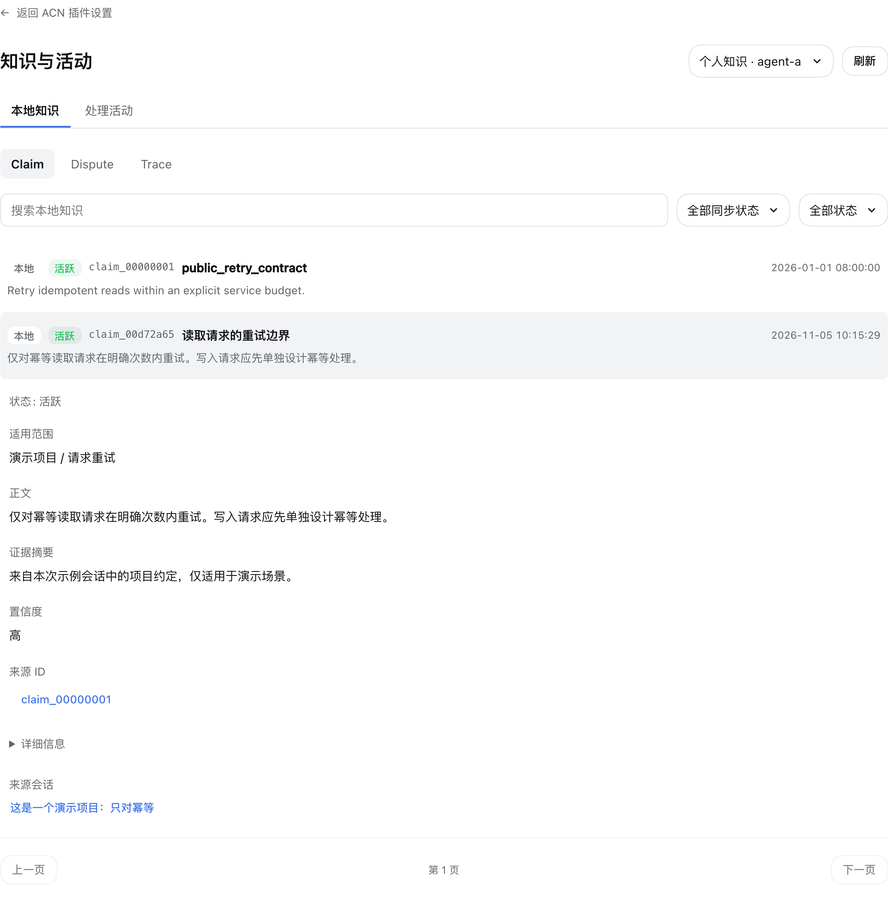
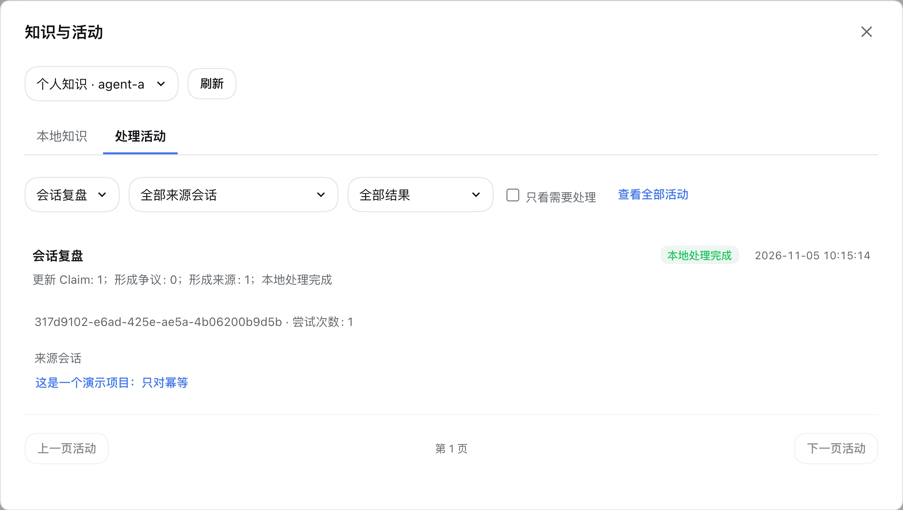
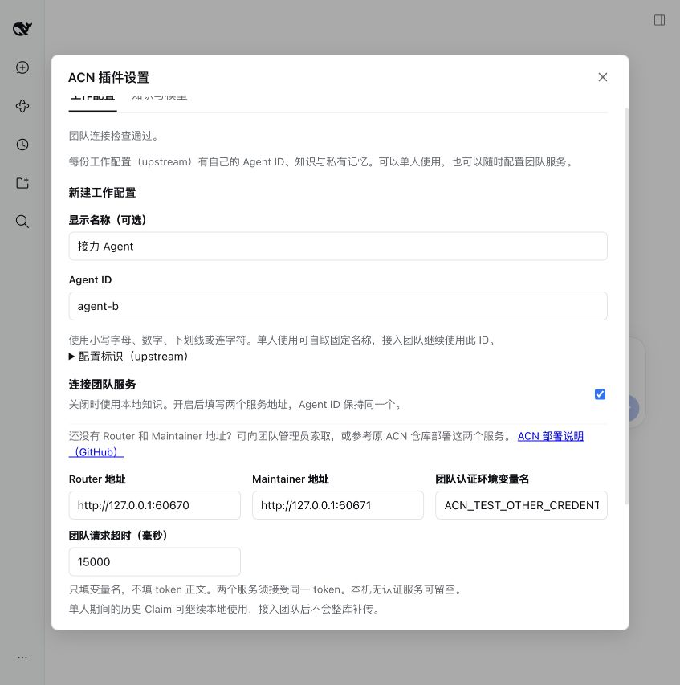

# ACN 记忆框架使用指南

[README](../README.md)

ACN 帮助你的 Agent 记住值得复用的工作经验。你可以先单人使用，积累自己的知识；需要协作时，可连接团队，分享结论并接收建议。

本文介绍 DSH 插件中的日常操作。截图来自隔离的 DSH 演示环境，使用示例身份、地址和知识，不包含真实成员信息；请按自己的配置填写。

- [首次使用](#首次使用)
- [在会话中使用知识](#在会话中使用知识)
- [查看知识与活动](#查看知识与活动)
- [接入团队](#接入团队)
- [记忆与知识整理](#知识整理)
- [遇到问题时](#遇到问题时)

## 首次使用

### 安装插件

在 DSH 打开「插件 → 添加插件」，填写提供者交付的 `.tgz` 安装包路径，完成安装并启用 **ACN记忆框架**。

当前 npm 包尚未发布；正式发布后，可在同一位置填写 `@ftai/dsh-plugin-acn`。安装使用预构建包，无需自己编译代码。若使用远程 DSH，安装包路径应是运行 DSH 的那台电脑上的路径。

如果已安装旧包名的版本，先在插件页卸载旧插件，再安装新包，避免同时启用两份 ACN。卸载插件不会删除知识目录中的数据。

### 建立自己的工作配置

打开插件详情中的「工作配置」，点击「新建工作配置」。也可以从 DSH 设置中的「ACN 插件设置」进入。

1. 填一个便于识别的显示名称，例如“个人知识”。
2. 填写固定的 **Agent ID**，例如 `agent-a`，以后继续使用这个身份。
3. 单人使用时，保持「连接团队服务」关闭，点击「保存配置」。

工作配置可以理解为一份独立的知识空间。同一配置下的不同项目可以复用知识；如果希望两份工作的知识分开，就新建两份配置。

列表中点击「配置」可以启停或设为默认。更换默认配置时会要求确认；默认值用于没有可用项目历史的新会话，不会替换旧会话的归属。

### 选择知识处理模型

切到「知识与模型」，选择可用的知识处理模型并保存。它负责会话复盘、团队消息处理和 Claim 整理，与输入框旁的聊天模型分别设置。

如果列表没有可用模型，先完成 DSH 的模型配置。知识目录通常保留默认值即可；需要调整时，可以点击文件夹图标选择，或用「打开目录」查看当前位置。修改目录不会自动搬移原数据。

## 在会话中使用知识

新建会话后，点击输入框旁的 **ACN**，确认本次使用的工作配置。新会话优先沿用同项目最近新建会话的有效配置，没有可用记录时使用默认配置；发送第一条消息前可以改选。

之后正常开展工作即可，例如查阅项目、排查问题或讨论方案。助手会按需查阅已有知识，并结合当前任务判断是否适用。

完成一段有价值的工作后，可在 ACN 菜单选择「复盘本次会话」，或输入 `/recap`。任务会在后台处理，可到「知识与活动 → 处理活动」查看结果。

有依据、带适用范围、值得以后复用的结论才可能保存。任务完成也可能没有新增知识，或只是修订已有记录。

日常不必每次手动复盘：默认会在达到一定对话量并空闲 5 分钟后整理；有少量新增内容时，空闲 1 小时也会整理。上下文压缩和归档会安排相应处理。详细条件见[命令与行为参考](command-reference.md#知识形成与失败重试)。

会话开始后，工作配置固定。想换知识空间或团队，请新建会话。安装前已开始的旧会话可以继续普通聊天，使用 ACN 时请另建会话。

## 查看知识与活动

从 ACN 菜单，或工作配置右侧的「知识与活动」进入。先确认页面上方选中的是你要查看的配置。

### 本地知识

| 类型 | 记录什么 | 阅读重点 |
| --- | --- | --- |
| Claim | 一条有适用范围的知识判断 | 正文、适用范围、证据、置信度 |
| Dispute | 多条知识之间尚待处理的分歧 | 相关知识、分歧内容和同步状态 |
| Trace | 一次知识处理的来源与产物 | 输入引用、输出知识、来源会话 |

点击一条记录展开详情。来源会话可以返回原聊天；Claim、Trace 引用可以继续展开，点击返回即可回到上一条详情。本地没有保存的来源会显示提示，不能仅凭这一点判断来源已经失效。

团队配置中的「已同步」表示当前版本已得到当前团队的上传确认；「等待投递」表示仍在本地队列中。没有上传回执的旧记录会显示为本地知识。

### 处理活动

  这里显示复盘、会话收尾、团队收件、知识内化、整理与投递的进度。可按类型、来源会话或需要处理的项目筛选；展开记录查看结果和错误原因。

“本地处理完成”表示本轮处理已结束；是否有知识产出、是否成功投递给团队，需要查看各自的结果。失败时先解决页面提示的问题，再使用记录上的「重试任务」「继续任务」或「重试团队投递」。

## 接入团队

### 先由团队部署服务

本插件提供 Agent 侧功能。**Maintainer（M）和 Router（R）需要由用户团队从 [ACN 官方仓库](https://github.com/FTShare-Lab/agent-claim-network) 自行安装部署**；部署、鉴权和服务参数以该仓库说明为准。

| 角色 | 在协作中负责什么 |
| --- | --- |
| Agent（A，本插件） | 执行任务，维护个人知识，分享结论并处理团队建议 |
| Maintainer（M） | 保存共享记录，发布团队规则，处理知识争议并发送建议 |
| Router（R） | 检索团队知识，返回相关候选和来源 |

部署完成后，管理员提供 **Agent ID、Maintainer 地址、Router 地址**，以及启用鉴权时的 **团队 Key**。普通成员取得这些信息后，在 DSH 中配置即可，无需照搬独立 ACN Agent 的终端配置步骤。

### 填写并检查连接

在「工作配置」打开已有配置，或新建一份团队配置，开启「连接团队服务」。

| 字段 | 如何填写 |
| --- | --- |
| 显示名称 | 自己容易识别的名称，例如“研究团队” |
| Agent ID | 管理员确认的成员身份 |
| Maintainer 地址 | 管理员提供的服务地址，保留协议、端口和部署路径 |
| Router 地址 | 同一套团队的检索地址，端口可能不同 |
| 团队鉴权密钥 | 管理员提供的 Key；免鉴权团队留空 |

填写服务地址、点击「检查连接」，弹窗中两项均通过后确认保存。

已有密钥的输入框留空会保留原值；输入新 Key 后保存会替换。需要移除时，使用页面的「移除密钥绑定」。

### 同步与复用团队知识

新会话选择团队配置后，先等待收件准备完成，再开始聊天。管理员刚发布规则或处理了争议，需要立即查看时，在 ACN 菜单点击「同步收件」，或输入 `/inbox`。

ACN Agent 侧的收件与处理分两步：先接收团队消息，再由知识模型结合本地情况处理。结果可能是新增、修改或保持现状。请在「处理活动」核对收到与处理的数量，再查看知识变化。

需要查找团队经验时，可以直接告诉助手：“查询团队关于这个问题的知识，并说明哪些结论适用于当前任务。” Router 返回候选知识，助手会判断如何采用；团队知识不会全部复制到每个成员的本地库。

团队模式下，整理出的知识和争议可能共享给团队。只想留在个人空间的工作，请使用单人配置。单人使用期间的历史知识仍可保留，后来接入团队不会将整库历史自动补传。

## 知识整理

本插件管理以 Claim 为主体的可复用经验，在接入团队时形成经验分享与流动；不维护私有 Memory 及其管理。知识提炼时会过滤工具名包含 `memory` 的工具调用及其结果（不区分大小写）。

**Dream**用于回顾和整理已经积累的知识。**默认开启自动整理，一般无需手动操作。** 使用该工作配置时，插件会在启动、创建会话时检查，DSH 运行期间每 4 小时再检查一次。自上次整理以来，至少 5 条不同的自有知识（Claim）新增或更新，且距离上次成功整理已满 24 小时，就会自动安排后台整理；首次整理无需等待 24 小时。

想提前整理时，可以输入 `/dream`；需要暂停时使用 `/dream stop`。进度和报告可在「处理活动」查看。整理会调用知识处理模型，正常结束也可能保留原样。

「偏好 → 显示知识处理结果」只控制来源会话中的短暂提示。关闭后，后台任务仍继续执行，完整结果仍可在「知识与活动」查看。高级参数通常保持默认，需要调整时再查[配置参考](config.md)。

## 遇到问题时

| 遇到的情况 | 先做什么 |
| --- | --- |
| ACN 菜单没有可用配置 | 确认插件已启用，创建并保存工作配置，再新建会话 |
| 连接检查失败 | 按弹窗提示核对对应服务的地址、网络、Agent ID 和 Key；请管理员确认服务正常 |
| 检查连接通过，但同步失败 | 回来源会话重试同步，在处理活动中查看本次失败原因 |
| 聊天正常，知识任务失败 | 检查知识处理模型是否可用，再重试失败任务 |
| 聊了很多，没有新 Claim | 先看活动是否完成；可手动 /recap 复盘。完成且产出为 0，表示本轮没有需要新增的知识 |
| 刷新知识页后看不到新团队规则 | 先同步收件，再查看处理结果；知识页刷新只更新本地列表 |
| 管理台与本地数量不同 | 管理台汇集团队记录，本地页面只显示当前工作配置下的知识 |

反馈问题时，提供 DSH 与插件版本、失败时间、错误提示和相关记录 ID 即可。截图中的 Key、账号、个人目录和团队内网地址应遮挡后再分享。

更多操作见[命令与行为参考](command-reference.md)，服务部署见 [ACN 官方仓库](https://github.com/FTShare-Lab/agent-claim-network)，兼容范围见[DSH 兼容说明](dsh-compat.md)。
