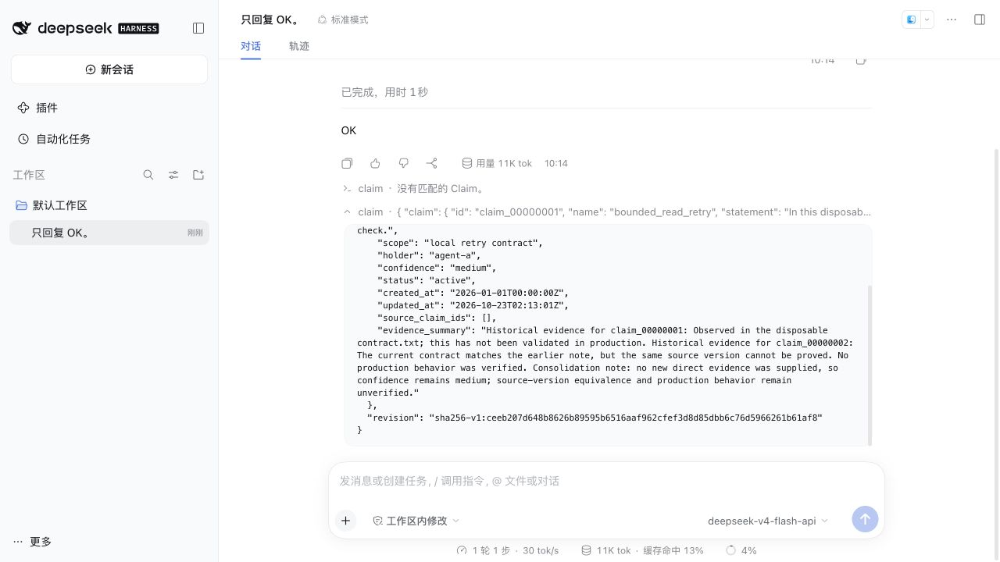

# Dream 证据保留与独立审查补充验收

日期：2026-10-23。基线为 `22e6357`，本次补齐原验收记录中的证据保留和独立代码审查缺口，仍未发布。

## 可确定检查的保留边界

此前模型可以完整引用 before，却用另一段较笼统的 after 摘要宣称信息已保留；维持 medium 不能代替“无法证明同一版本”的具体限制。现在以完整原 evidence_summary 为保守单位，不猜测语言或关键词：

- A/B/C 的同 ID 输出必须逐字保留原摘要，包括废弃历史；可标注为历史依据并追加本轮证据、版本与适用限制。
- C 的每条输入还必须在 coverage 指定的至少一个存续输出摘要中完整留存，不能只留在废弃历史、其他输出或正文。
- 草稿预检、复核和最终提交均检查；整合交付重绑也检查当前承接。旧未 prepared 草稿会清除旧复核后携带具体反馈重新起草。
- 已 prepared 的固定目标继续按原恢复契约完成，不追溯改写已接受的旧提交；普通显式 Claim 编辑不受这条 Dream 专属规则限制。

Claim/Trace DTO、revision、Dream schema 和 checkpoint 格式未增加字段。原文留存不证明事实正确、证据独立或新旧解释语义一致；正文条件与新说明仍需要语义复核。摘要可能累积，无法安全容纳时可以 keep，不强求整合。

## 回归与兼容验证

相较基线新增 25 项测试：20 项证据保留、提交与升级恢复测试，5 项调度测试。旧实现允许有损整合，并在禁用处理器的排队场景中反复让位；相应回归在修复前失败。

保留回归包括中英文版本/生产验证/证据完整性限制、原文仅留在历史或正文、笼统改写与否定替换、错误 coverage 去向、quality 改写、具备新直接证据的 B 校准、无写入拒绝直接提交、反馈后修复、旧未提交草稿重起草、旧 prepared 固定目标恢复，以及旧有损重绑授权的拒绝和 abandoned 回执。

| 检查 | Node 22.23.3 | Node 24.22.0 |
| --- | --- | --- |
| strict 类型、ESLint、安全扫描、文档链接 | 通过 | 通过 |
| 全部常规测试 | 50 文件、735 项通过 | 50 文件、735 项通过 |
| Rust YAML 回读 | 47 项通过 | 47 项通过 |
| 真实 Router/Maintainer 契约 | 6 项通过 | 6 项通过 |
| 构建、打包、真实安装、Loader 与引擎门禁 | 通过 | 通过 |

15 份模板快照和 9 组 revision 基准继续通过；模板快照已由参考 Rust 引擎重新导出，参考仓库未修改。两项最后补充的恢复用例加入后，两套 Node 的完整常规测试重新执行；协议、契约和安装检查使用相同的最终生产代码。

## 真实模型与宿主

两次均使用实际 tarball、DSH `0.2.1-rc.2`、临时知识根和虚拟公共 Claim，所有后台模型调用为 `deepseek-v4-flash-api`，输出上限为插件默认 16384。没有使用真实私有知识或放宽检查。

| 场景 | 实测结果 |
| --- | --- |
| 旧有损草稿和旧 apply 复核恢复 | 预置候选及故意遗漏来源版本限制的旧记录；新规则使旧复核失效，真实模型重新起草、复核并提交，任务一次领取后 succeeded |
| 无预置草稿的新 Dream | 通过真实 /dream 完成发现、起草、复核和整合；任务一次领取后 succeeded |
| 证据原文核对 | 两次的存续 Claim 都逐字包含两份原摘要，明确保留“无法证明同一来源版本”和“生产环境未验证”；废弃历史也保留自身原摘要，置信度保持 medium |
| 无效模型复核 | 两次均出现一份把废弃 Claim 当作保留去向的复核，既有硬校验拒绝；反馈后的复核通过，未放宽规则 |
| 禁用处理器的真实队列 | 新任务场景关闭 Memory review，保留其排队任务；Dream 正常完成，Memory review 仍 queued、attempts=0，无失败任务 |

每次两条 Claim 整合为一条活跃、一条废弃，并产生组和收尾两份 Trace。核对依据是实际 YAML、progress/report 和不含正文的模型路由审计，不只看模型自述。

复验数据生成与启动命令见[发布准备](../release.md)。旧草稿场景刻意预置了候选；新任务场景的候选由真实模型发现。两次抽样不构成知识质量基准或跨模型保证。

## 独立审查与 P1 修复

使用 `code-review` 流程的独立只读 CLI 审查，明确禁止递归审查、委派和文件修改。初次更换为 `gpt-6-astra` 后，原 CLI `0.145.0` 返回“需要更新 CLI”；在临时目录安装官方 npm 包 `@openai/codex@0.163.0` 后，两轮审查均实际完成并返回最终报告，退出码为 0。未更改全局 CLI 默认模型。

第一轮审查 `22e6357` 的不可变完整源码快照，发现 1 项 P1、没有 P0：处理器被禁用后仍有 queued 的高优先级任务，Dream 会无限让位、重新领取、撤销 attempt 计数并持续写盘。退避中或暂停的任务也可能触发同一问题。

修复后，queue.claim、入队时抢占、worker 跨进程监控和 Dream 阶段边界共用 runnableJob：queued、未暂停、处理器已注册、nextRunAt 到期。任务保留，恢复可执行后继续消费。回归覆盖启动前的禁用/暂停/退避、运行中本实例与其他实例入队、不无谓取消 Dream，以及重新启用后的消费。真实宿主场景也验证了禁用 Memory review 时 Dream 继续完成。

第二轮对照基线审查最终生产代码及相关测试、fixture、模板与脚本，结论为“未发现可确认的 P0/P1 缺陷”，并确认原 P1 已修复。两轮 JSONL、stderr、最终报告均保留在本机临时审查目录；本文件保留结论及验证范围。只修复 P1 及以上问题，未扩展到 P2/P3 清理。

独立审查为静态检查，没有代替执行测试。复审提出的旧 prepared 和旧重绑授权测试缺口已由最后两项回归补充；未穷举 Dream 运行中到期、解除暂停与处理器卸载的所有交错。远端 CI 未运行，仍以本地双 Node、真实宿主和契约结果为证据。
