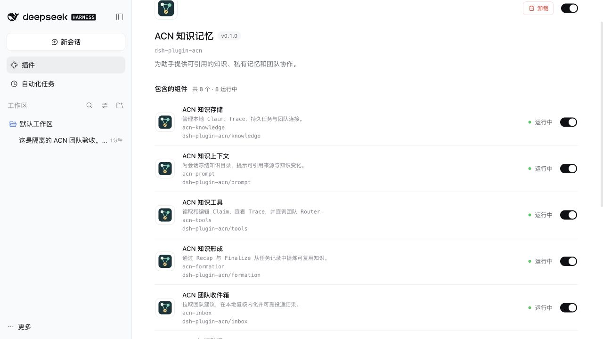
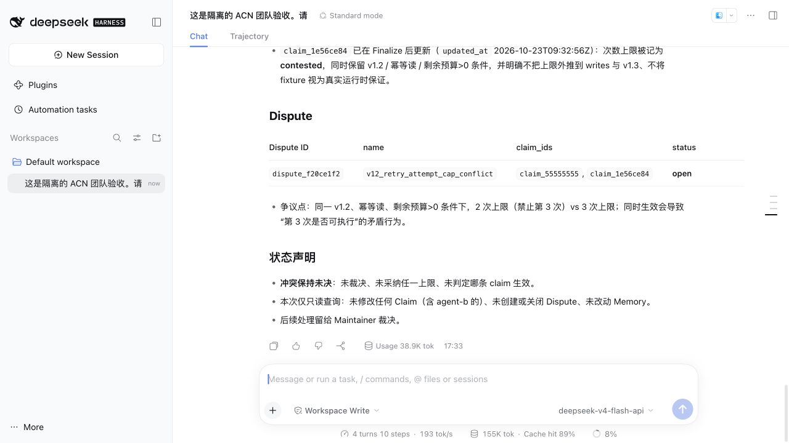

# Inbox、Dream 与真实团队补充验收

日期：2026-10-23。目标是在前次审查基线 `6cc2694` 上修复 Inbox P1，定位并经用户确认修复 Dream 复核失败，补齐中英文元数据与图标，并实际使用 DSH 连接本机团队服务。没有发布或推送；验收数据与日常知识、服务数据分离。

## Inbox 关闭边界

原实现第一批调用 `prepared()` 后没有重置状态；在第二批等待模型时卸载 Inbox，worker 会误以为仍处于固定提交阶段，既不取消模型，也不等待任务结束。确定性屏障可复现关闭之后第二批仍写入 Claim。

修复每批提交完成时的 `committed()`，增加服务生命周期取消信号与在途操作等待。关闭可取消显式拉取和后台模型；已经 prepared 的批次仍完成固定提交，随后停止下一批和该处理器的后续投递，释放未完成消息。持久任务留在 queued，重新启用恢复，其他已注册处理器仍可运行。

新增四项回归覆盖第一批和第二批模型等待、prepared 之后关闭、显式拉取期间关闭，并检查重新启用、其他任务可用和没有重复效果。原有并发与 SIGKILL 恢复测试继续通过。

## Dream 定位、确认与修复

前次任务只有五次 `invalid` 审计，没有保存响应正文，不能逐次还原其具体错误。本次在仓库外使用该任务保存的原 review 输入和 `deepseek-v4-flash-api` 重放，五次均正常结束，但依次出现：

1. JSON 字段缺少冒号等语法错误。
2. `self_review.support` 项多出 `reason_placeholder`，根对象多出 `support`。
3. 多余字段换成 `reason_note` 和根层 `review`。
4. JSON 引号或逗号错误。
5. preservation/support 的 after 引用了即将 deprecated 的输入，把历史留存当成存续信息承接。

重试反馈原来只给出字段路径和 `unrecognized_keys`，未指出需要删除的字段；最终错误也未区分阶段和失败类别。用户已确认采用保留严格校验的修法。

现在模板明确根对象与复核嵌套示例、完整字段引用及存续承接约束，减少冗长重复解释。额外字段反馈给出具体字段名；引用反馈给出 side、Claim ID 和字段。持久审计只增加 phase、失败类别及 schema 错误代码；不保存响应正文、引用文字、额外字段名或私有内容。JSON、逐字子串、全文覆盖、版本、来源、原证据完整保留与置信度校验均保留。

新增三项回归覆盖连续语法/额外字段/废弃承接错误、达到上限后持久重试、英文句号被改成中文句号时仍拒绝，并确认失败前零写入、诊断不泄漏响应正文、最终原限制完整保留。

修复后同一原输入直接重放：第一轮把英文句号换成中文句号，被严格拒绝；第二轮 apply 通过。随后将修复包真实安装到原 DSH profile，执行 `/acn-status retry <原任务 ID>`：真实宿主的 review 第一次通过，随后 compaction 成功，原候选 executed、任务 succeeded。新增组提交和收尾两份 Trace，总计 4 条 Claim、4 份 Trace。

落盘核对：存续 Claim 的 evidence_summary 包含两条输入的完整原摘要；statement 保留 v1.2、v1.3 未验证、写请求单独幂等检查及 remaining>0；confidence 保持 medium；被整合输入为 deprecated；其他 high Claim 原样保留。模型复核通过仍不等于系统性的语义正确率保证。

## 本地化与安装资源

组合包以及 knowledge、prompt、tools、formation、inbox、dream、memory、commands 八个组件均导出 `locale/en.json`、`locale/zh.json` 和 `icon`。原创 SVG 遵循项目许可证。实际 tarball 安装后逐项解析资源、检查图标格式与大小；真实 DSH 界面切换中英文，名称、功能说明、图标均显示，八个组件正常运行。

## DSH 接入真实 Router 与 Maintainer

本次使用 ACN `0.3.3`（参考提交 `c542b19`）的两个真实二进制，分别绑定本机回环端口，使用独立服务数据根。团队鉴权开启，Agent A/B 和管理员凭据运行时生成，磁盘只存团队 key 哈希；DSH 配置仅保存环境变量名。DSH `0.2.1-rc.2` 的对话及 ACN 后台调用均使用 `deepseek-v4-flash-api`。没有使用 HTTP stub 或脚本模型代替这条实际使用链路。

| 场景 | 已核实结果 |
| --- | --- |
| 查询其他成员知识 | Agent B 通过真实 Maintainer 上传；DSH 模型实际调用 consult_router，取回 holder=agent-b 的 Claim，准确报告最多 3 次、v1.2 限定和未验证范围 |
| Policy 拉取与内化 | 管理接口发布 Policy；DSH `/inbox` 显示拉取/持久化/ACK 各 1，真实模型修订本地 Claim，真实 Router 随后查到含该 Policy 来源的新版本 |
| Policy 撤回与属性建议 | 真实服务分别发布撤回和 CAU；DSH 一次拉取 2 条并完成处理，依赖撤回 Policy 的本地 Claim 废弃；模型保留无须额外改写的建议 |
| 实际关闭取消 | 另一次模型内化开始后，通过 DSH 插件开关关闭 Inbox；约 0.8 秒时取消调用，任务 queued、消息 pending、没有新增 Claim，组件显示关闭 |
| 离线内化与持久上传 | 停止 Maintainer 后重新启用 Inbox，同一任务从本地持久消息恢复成功，新增 Claim 留在上传队列；队列包含完整来源、版本及未验证范围 |
| 恢复后自动补传 | 重启同一 Maintainer，未手工触发知识变更或投递；等到下一次 10 分钟定时补传，pending 文件消失，Router 查询返回 Agent A 的完整新 Claim |
| Finalize 与冲突上报 | 虚拟项目文件要求最多 2 次，而团队 Claim 允许 3 次；DSH 读文件、查询 Router 后执行 `/acn-finalize`，修订本地 Claim 并将 `dispute_f20ce1f2` 投递到真实 Maintainer。Router 返回双方 Claim 的 open_dispute_ids 及 open Dispute；没有假定仲裁完成 |
| 私有 Memory | DSH 实际调用 memory 写入合成测试标记；Finalize 和投递完成后再次扫描，团队 20 个数据文件没有该标记 |

Finalize 后，DSH 再次实际调用 `consult_router`，回读双方 Claim、共同的 open_dispute_ids 和 open Dispute。上传的 Claim / Dispute 均不含私有测试标记；本地 Trace 的 task 保留了用户原始测试指令，其中含该标记，Trace 始终只在本地，不参与团队投递。

本次真实服务使用 scope 检索，未启用 Router 的模型语义重排与 Maintainer 的自动模型仲裁；这两项属于团队服务的额外配置，本记录不把它们算作已验收。插件的真实服务契约测试另覆盖身份/所有权拒绝、Dispute 去重、整合依赖投递、校准 Claim 上传及服务失败恢复。

## 自动化验证范围

本次使用 Node `24.22.0`：742 项常规测试（52 个文件）、47 份 Rust YAML 回读、6 项真实 Router/Maintainer 契约通过；strict 类型、ESLint、安全扫描、25 份 Markdown 文档链接、构建和实际安装冒烟通过。安装同时验证默认、证据校准、私有 Memory 三组流程和不兼容宿主引擎拒绝。本次没有把前次 Node 22 或远端 CI 结果计为重新验证。

## 独立审查

使用 CLI `0.163.0`，按本机配置的 `gpt-6.1-sol` / max 运行独立只读审查，正常退出（exit 0），返回未发现 P0/P1。检查包含未跟踪测试及全部中英文资源，重点追踪 Inbox 取消、prepared/committed 边界、插件卸载、持久恢复、Dream 严格校验及诊断隐私。仅关注现实触发的阻断问题，不把极小概率猜测列为发现。

该审查只负责源码和资源检查，没有独立运行测试或复验真实服务；本记录中的自动化和实际使用结果由主验收流程执行。模型审查结论不构成无缺陷保证。
