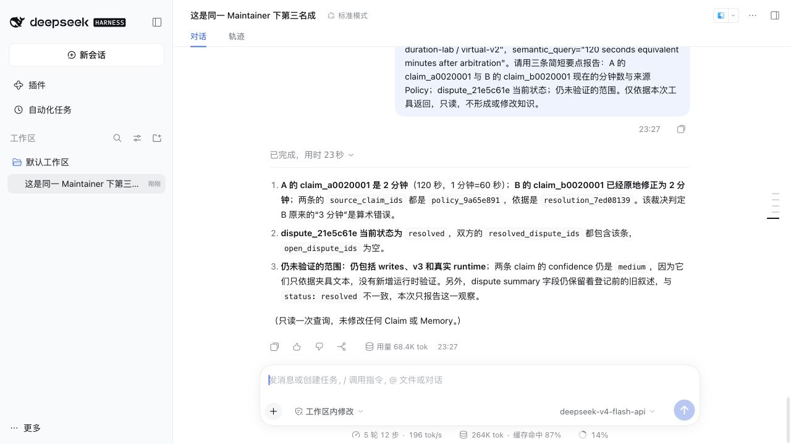
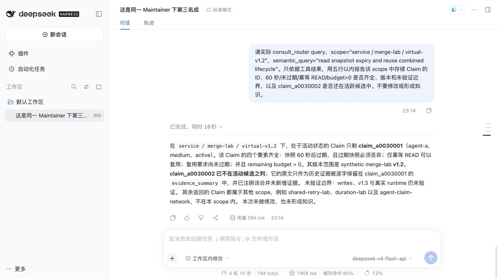

# 真实模型团队闭环验收

日期：2026-10-23。接续[前次真实团队验收](2026-10-23-inbox-dream-team.md)，本轮启用 Router 模型语义重排和 Maintainer 自动模型仲裁，并让三个真实 DSH 插件成员连接同一个 Maintainer。没有修改 ACN 服务源码，也没有人工采纳模型裁决。

## 环境与证据范围

| 项目 | 本次配置 |
| --- | --- |
| 插件 / 宿主 | 本地安装包 `0.1.0` / DSH `0.2.1-rc.2` |
| 团队服务 | ACN `0.3.3`，参考提交 `c542b19`，真实 Router 与 Maintainer 二进制 |
| 成员 | agent-a / agent-b / agent-c，独立 DSH_HOME、知识根和虚拟工作区 |
| 模型 | 对话、插件后台、Router 重排、Maintainer 提案与验证统一使用 `deepseek-v4-flash-api` |
| Router | retrieval / rerank 开启；词法召回，未配置 embedding |
| Maintainer | arbitration enabled、mode=auto、confidence_threshold=0.90 |
| 鉴权与观测 | 回环地址、团队与管理员鉴权；透明代理转发真实模型请求，只记录角色、阶段、模型、状态和耗时 |

代理不替模型生成内容；仅在明确的故障场景给 Router 模型请求返回 503，及在并发场景暂缓一个 Dream 请求。模型及 Agent 调用凭据只传入子进程环境，仓库不包含运行配置、凭据、响应正文或本机私有知识。所有知识材料是合成夹具；初组 Claim 来自真实 DSH 读文件与 Finalize，后续时长争议和整合用例使用明确预置的公共 Claim。

实际模型延迟可能超过插件默认团队请求超时。本轮验收设 `team.timeoutMs=180000`，未改变产品默认 15000。复验参数见[发布准备](../release.md)。

## Router 模型重排与降级

DSH 的 `consult_router query` 实际访问真实 Router，服务侧确实发起指定模型请求。恢复后的同一查询记录 `rerank_fallback=false`、无错误，并观察到候选名次变化：例如缓存 Claim 从第 4 到第 3，治理 Claim 从第 7 到第 4。不是仅凭 HTTP health 或助手口头回答判断重排成功。

给 Router 模型注入 503 时，真实 DSH 查询仍返回 `available=true` 和可引用候选；直接协议观测记录 `rerank_fallback=true` 及 503 原因。撤销故障后真实重排恢复。此处 `mode=lexical_only` 描述候选召回方式，不表示未执行模型重排；embedding 不在本轮验收范围。

插件工具有意只返回候选和 Dispute，不暴露 `retrieval_debug`。验收把真实工具结果、服务协议调试信息和模型代理元数据交叉核对，不把工具缺少调试字段推断为重排失效。

## 治理 Policy 与自动仲裁

A、B 在各自虚拟项目读到不同的 v1.2 重试契约，经真实 `/acn-finalize` 形成并上传 `claim_942df229`（含首轮最多 2 次）和 `claim_1a8e5d94`（最多 3 次）。A 通过真实 Router 发现冲突，Finalize 上报 `dispute_e81b53e5`。

治理 Policy `policy_b3e12959` 明确规定同一合成项目采用 2 次上限，并保留幂等 READ、remaining budget > 0、writes/v1.3/runtime 未验证的边界。Maintainer 自动提案和独立验证均成功，第一轮因 Router 候选变化重新分析，第二轮自动生成 `resolution_e15ad4fa`，`resolved_by=automatic`、`resolution_basis=policy`。

停机期间，两名成员尚未内化消息。重新启动真实 DSH 后，A、B 各自拉取、持久化、确认并处理 2 条消息；本地 Claim 统一为 2 次并上传，C 随后实际查询到双方新版本及 resolved Dispute。两名成员先内化治理 Policy，随后对已满足的仲裁建议作无额外修改的处理；因此这一组不能单独证明“仲裁属性建议直接改写 Claim”，另设无前置治理 Policy 的时长冲突验证该路径。

## 自动仲裁建议直接内化

预置相同 `service / duration-lab / virtual-v2` 范围的两条公共夹具 Claim：A 的 `claim_a0020001` 写作“120 秒＝2 分钟”，B 的 `claim_b0020001` 错写“120 秒＝3 分钟”，两条同时明确 1 分钟＝60 秒、过期不复用及 writes/v3/runtime 未验证。A 在真实 DSH 中读取自身 Claim、通过 Router 查询 B，再用 `/acn-finalize` 上报 `dispute_21e5c61e`；没有给这组预置治理 Policy 或手工裁决。

并发期间候选知识变化使前两轮未采纳，ACN 按现有 5 分钟、15 分钟退避自动重新分析。第一段等待期间强制终止 Maintainer（SIGKILL），同一数据根重启后保留原任务和重试时间。等到输入稳定，第三轮于北京时间 23:23:49 自动开始，23:25:49 生成 `resolution_7ed08139`：`resolved_by=automatic`、`resolution_basis=direct_analysis`，提案/独立验证置信度为 0.92/0.93，均超过 0.90；没有调用人工 Analyze 或采纳接口。

该裁决明确用两条 Claim 自身声明的单位关系判定 120/60=2，指出另一项目的重试/缓存 Policy 不适用，同时保留未验证边界。随后实际 `/inbox` 在 A、B 各拉取、持久化并确认 1 条 `policy_9a65e891` 属性建议：

| 成员 | 内化与传播结果 |
| --- | --- |
| A | 修改自身 `claim_a0020001` 的未决叙述及自身关联治理 Claim；保留 2 分钟与未验证边界，没有修改 B 的本地文件 |
| B | 将 `claim_b0020001` 原地改为 120 秒＝2 分钟；保留过期不复用、medium、writes/v3/runtime 未验证及历史纠错依据 |
| Maintainer | 两名成员均 ACK，后续上传已被观察为 `update_observed`，Claim 含 `policy_9a65e891` 来源 |
| C | 再次通过真实 `consult_router` 回读双方的新版本与 resolved Dispute，不需要本地复制或直接访问其他成员目录 |

最终核对 12 条本地 Claim（含废弃历史）与各自团队镜像逐条一致，所有持久任务成功、上传队列为空。服务只发建议，实际本地改写由各成员模型内化完成；仲裁完成与成员内化完成分别核验。

截图中模型提到 Dispute summary 仍有旧叙述：该字段保留原始上报描述，当前生命周期应看 `status`、`resolution` 和 Claim 的 `resolved_dispute_ids`。本次三者一致；没有把历史上报正文改写为裁决正文，也没有将模型的这条观察直接判成管线故障。

## Dream 并发与整合

| 场景 | 实际结果 |
| --- | --- |
| Inbox 抢占草稿调用 | 原任务 `918358af-9bec-4690-acca-48f60544c5d3` 的草稿请求等待时收到真实 Policy；调用被取消，Inbox 先内化 |
| 旧草稿恢复 | Inbox 修改了原候选版本；Dream 恢复后将该组标记 skipped，没有覆盖新知识 |
| 另一成员同时整理 | B 的 Dream `115483b7-b2bd-45e8-b4bf-cba8ba5ec86d` 成功、零修改；没有越权纠正争议数值 |
| 争议期间质量整理 | A 的 `11b952de-caf3-46e3-971f-a1a0ef001bb8` 更新自身 Claim 的情景表述；保留数值与未验证限制，Maintainer 对变化重新检查 |
| 真实主题整合 | `e3017400-c445-484f-8762-94e98128e425` 完成整合与质量清理两组，更新 3 条 Claim |

主题整合中，`claim_a0030001` 承接 60 秒过期丢弃、幂等 READ、remaining budget > 0 和未过期条件；保留 v1.2、writes/v1.3/runtime 未验证、两份完整原 evidence_summary，confidence 仍为 medium。`claim_a0030002` 废弃但历史原文保留。

Maintainer HTTP 审计确认先成功接收存续版本，再接收废弃版本。三名成员的本地 Claim 与各自团队镜像逐条一致，上传队列为空；C 的真实 `consult_router` 查询取回整合后完整规则，废弃 ID 不再出现在活跃候选中。

第一次整合草稿混入另一 duration-lab 议题的冲突短语；真实 review 返回 repair，指出无依据的新断言。下一次草稿移除该内容并通过复核后才提交。这个抽样展示修复链路可用，不意味着模型复核总能识别语义污染。

## 修复与回归

本轮原始重复 Claim 草稿连续失败，未写入知识。对原输入的直接重放复现了“keep 一条、deprecate 另一条，但没有改写存续正文”违反整合约束；原失败的五份响应正文未持久保存，不能断言它们全部具有同一原因。

保留原硬校验，补充 `operations[].changes.statement` 的具体要求、change_basis 与变更 ID 的对应规则，以及没有安全整合收益时合法 `action=keep / reason_kind=no_consolidation_benefit` 的出口。不能为通过校验机械改写。修复后再次用原输入调用真实模型：首次 JSON 语法错误被拒，第二次合法 stage 通过。该直接重放不写知识；真实 DSH 的并发恢复和新任务结果单独列于上文。

新增两项持久 worker 回归：错误草稿被拒后分别提交有效修复和主动保留，检查具体反馈、重试前 Claim/Trace 零写入、最终 Claim 及审计结果。Rust 模板引擎重新导出对应快照；没有放宽引用、版本、原证据留存或置信度规则。

## 自动化与独立审查

Node `24.22.0`：744 项测试（53 个文件）、47 份 Rust YAML 回读、6 项真实 Router/Maintainer 契约通过；strict 类型、ESLint、安全扫描、26 份 Markdown 链接、构建、最终 tarball 和真实安装冒烟通过。未把历史 Node 22 或远端 CI 结果算作本轮重新执行。

按 code-review 技能运行一次独立只读 CLI 审查，CLI `0.163.0`、配置默认 `gpt-6.1-sol / max`，exit 0，未发现现实触发的 P0/P1。范围包括全部代码差异、未跟踪的新测试、Dream 校验/重试/恢复及验收脚本。审查模型与被验收的 ACN 运行模型分开；外部审查没有运行真实模型或团队服务请求。

本轮不发布、不推送。实际调用、自动裁决及落盘结果只证明这些具体场景的链路和恢复行为，不构成通用事实正确率、整合等价性或多模型质量保证。
